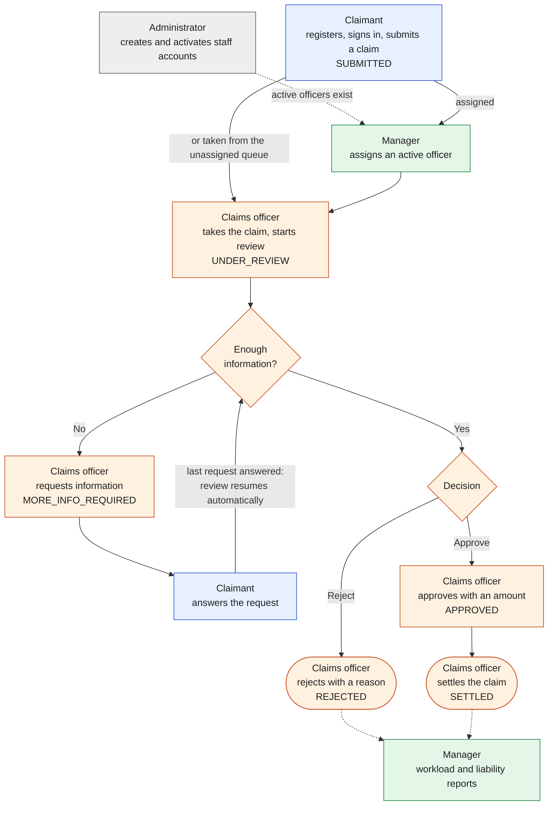
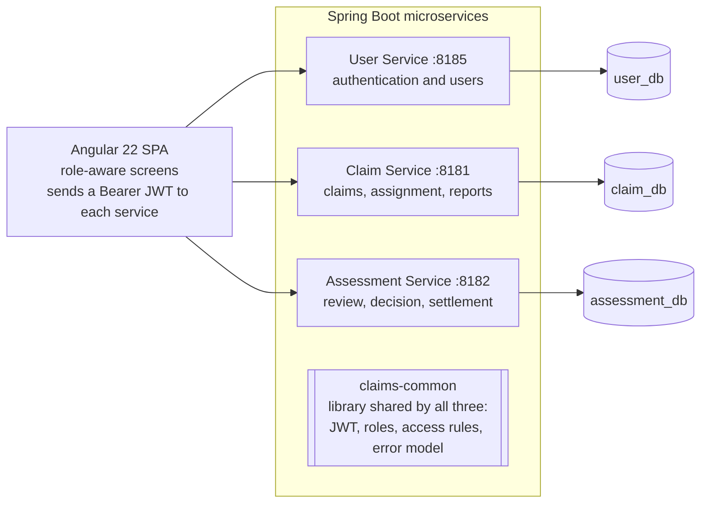
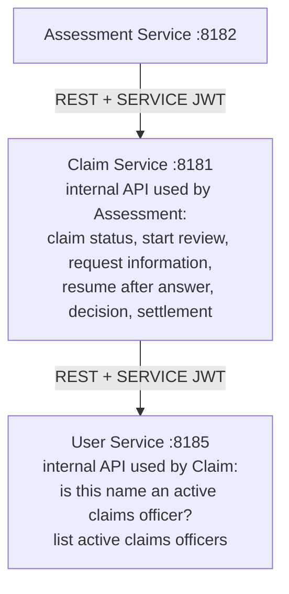
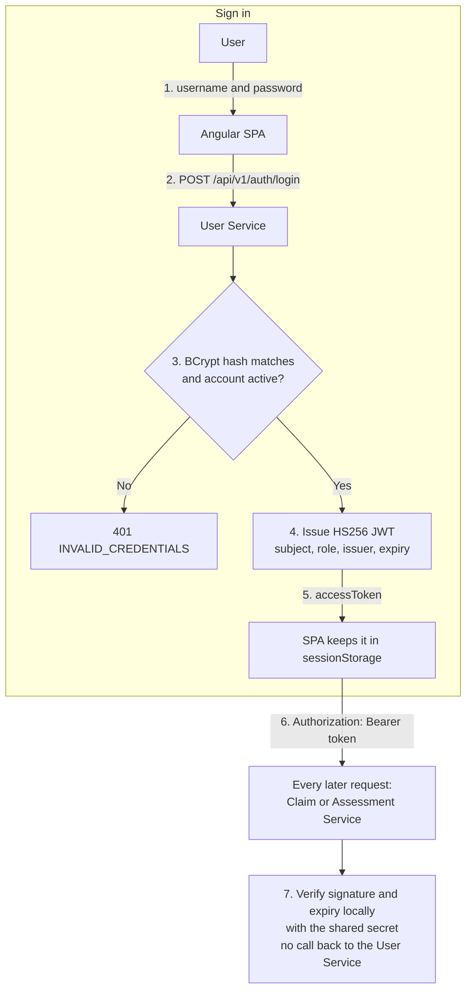
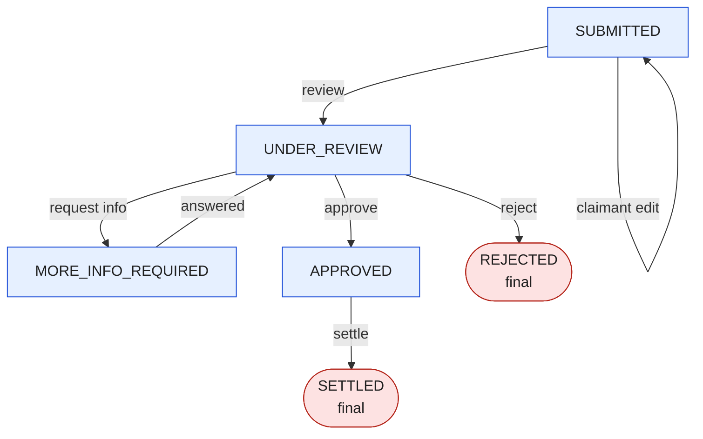
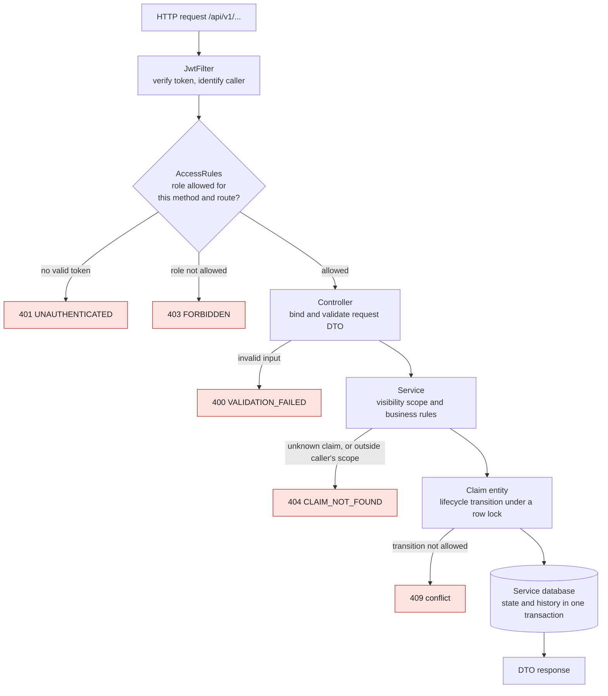
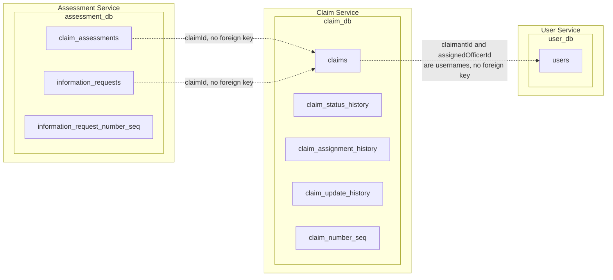
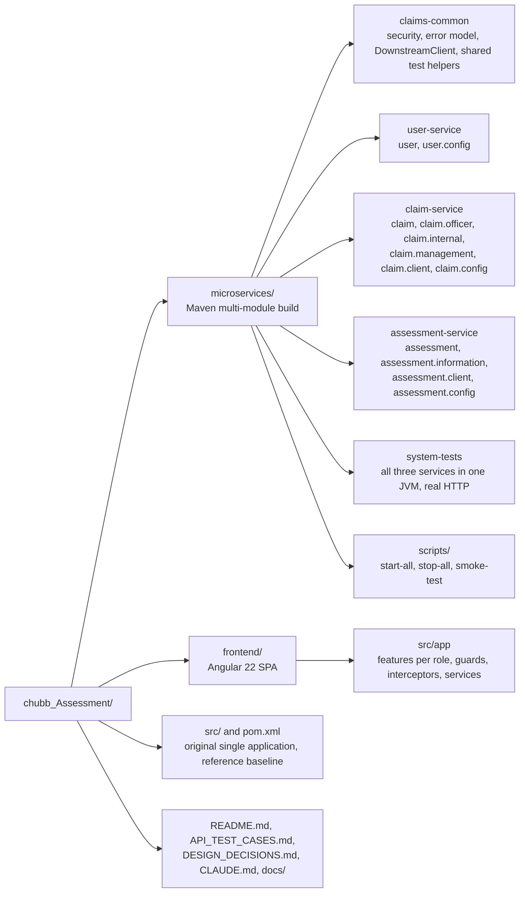

# Chubb APAC Claims Management System

A claims platform built as three Spring Boot microservices and an Angular front end. A claimant submits a claim, a claims officer reviews it (optionally asking for more information), approves or rejects it, and an approved claim is settled. Managers see workload and liability reports; administrators manage users.

> **This is a demonstration system, not a secure deployment.** It ships with well-known demo accounts and a shared signing secret; see [Known limitations](#known-limitations).

Jump to: [Run it](#running-the-system) · [Test it](#testing) · [API contracts](API_TEST_CASES.md) · [Design decisions](DESIGN_DECISIONS.md)

## Roles

| Role | What they can do |
|---|---|
| **Claimant** | Register and sign in; submit, track and (while `SUBMITTED`) edit their own claims; answer information requests; read the claim's histories. |
| **Claims officer** | See unassigned claims and their own; take a claim; review, request information, approve or reject, settle; read the assessment history. |
| **Manager** | See every claim; assign a claim to any active officer; officer workload and liability reports. |
| **Administrator** | Create users, change roles, activate or deactivate accounts. Allowed on every public route; when acting for an officer, must name that officer. |

## End-to-End Business Workflow



Who does what, from submission to reporting. Every node names its actor (also colour-coded: blue claimant, orange officer, green manager, grey administrator). `smoke-test.ps1` replays this flow against the running services.

## High-Level Architecture



| Service | Responsibility |
|---|---|
| **User** (Auth Service) | Registration, login, JWT issue, user administration, lookup of active claims officers. |
| **Claim** | Create, search and edit claims; assignment; status, assignment and edit histories; the lifecycle rules; management reports. |
| **Assessment** | Start review and assessment notes; information requests and answers; decision; settlement; assessment history. |

There is no gateway or service discovery. `claims-common` is a library (no domain code), not a fourth service.

## Service-to-Service Communication



- The dependency chain is fixed and acyclic: **Assessment → Claim → User**. The User Service calls nobody; nobody calls the Assessment Service.
- Each call goes through one client class (`ClaimClient`, `UserClient`) and carries a fresh 60-second `SERVICE` token, never the caller's own token.
- A client re-raises the peer's 400/404/409, maps an unreachable peer to 503 and anything else to 502. It never retries.
- Consistency across services is **best effort**: the Assessment Service writes its row, calls the Claim Service before commit, and rolls back if it refuses. A timeout can still hide a success.

## JWT Authentication Flow



- Only the User Service issues person tokens. Every service needs the **same `JWT_SECRET`** (32+ characters, no default); a service refuses to start without it.
- Passwords exist only in the User Service, only as BCrypt hashes. A deactivated account gets the same 401 as a wrong password.
- A token lives for `JWT_EXPIRY` (default 60 minutes) and cannot be revoked earlier.

## Claim Lifecycle



- The transitions are enforced inside the `Claim` entity in the Claim Service, never in a controller. An invalid one is a **409**. The Assessment Service drives them through the Claim Service's internal API.
- A claim leaves `MORE_INFO_REQUIRED` automatically when the last `OPEN` information request is answered. An officer can also resume it with a review, but only while no request is `OPEN`.
- Review, request information, decision and settlement need the **assigned** officer (409 `OFFICER_MISMATCH` otherwise). Assignment changes the officer, not the status.
- An approval needs an amount greater than 0 and no more than the claimed amount, in the claim's currency. A rejection has no amount. A second decision is a 409, and a rejected claim can never be settled.
- A claimant can edit only a `SUBMITTED` claim (409 `CLAIM_NOT_EDITABLE` afterwards).

## Request Processing Flow



- Every error, whichever stage raises it, has the same body: `{timestamp, status, error, code, message, path}`, with no stack trace.
- Authorization is the per-service `AccessRules` table, not annotations. `/internal/v1/**` accepts only a `SERVICE` token, enforced once in the shared security chain.
- Visibility is one rule (`ClaimVisibility`): a claimant sees their own claims, an officer the unassigned ones and their own, a manager and an administrator all. A claim outside that scope answers exactly like an unknown one (404), so its existence is not revealed.
- Entities are never returned; the API returns DTO records.

## Database Ownership



- **One database per service.** No service reads or writes another's tables; data is shared only through REST. References across services are logical (`claimId`, username), never foreign keys.
- Public IDs are server-generated from sequences: `CLM-<year>-<6 digits>` for claims and `IR-<year>-<6 digits>` for information requests. The internal `BIGINT id` is never used in a route.
- The history tables are append-only; nothing updates or deletes a row.
- Flyway owns each schema (`db/migration/<service>/`) and Hibernate only validates it (`ddl-auto=validate`). The default database is **in-memory H2**, so data is lost on restart. PostgreSQL is opt-in, with the database names above.

## Project Structure



Packages inside a service are by feature, under `com.chubb.claims`. The original single application at the repository root still builds and is kept unchanged as a baseline; it has no authentication and also defaults to port 8181.

## Technology Stack

| Layer | Technology |
|---|---|
| Backend | Java 17, Spring Boot 3.3.5, Spring Web, Spring Data JPA, Bean Validation, Spring Security, jjwt, `RestClient` |
| Data | Flyway; H2 (default, in memory); PostgreSQL (opt-in) |
| API docs | OpenAPI 3 and Swagger UI (springdoc) |
| Front end | Angular 22, Angular Material, Chart.js |
| Build and test | Maven Wrapper; JUnit 5, MockMvc, Mockito; Vitest (front end) |

## Running the System

**Prerequisites:** Java 17 (the Maven Wrapper is included). Node.js 22.12+ for the front end.

```powershell
.\microservices\scripts\start-all.ps1                 # build, then start User, Claim, Assessment in order
.\microservices\scripts\start-all.ps1 -SkipBuild      # jars already built
.\microservices\scripts\smoke-test.ps1                # optional: replay the demo flow as real users
.\microservices\scripts\stop-all.ps1                  # stops only what start-all.ps1 started

cd frontend; npm install; npm start                   # http://localhost:4200
```

If `JWT_SECRET` is not set, `start-all.ps1` generates a random one for that run (never printed or saved), so tokens die when you stop. Port 8181 is often taken (the original application uses it too); pass `-UserPort`, `-ClaimPort` or `-AssessmentPort` and the other services are pointed at it. The front end dev server proxies `/svc/*` to the services because the backend sends no CORS headers.

| Service | Port | Health (no token) | Swagger UI |
|---|---|---|---|
| User | 8185 | `/actuator/health` | `/swagger-ui/index.html` |
| Claim | 8181 | `/actuator/health` | `/swagger-ui/index.html` |
| Assessment | 8182 | `/actuator/health` | `/swagger-ui/index.html` |

Prefix each path with `http://localhost:<port>`. Health answers `{"status":"UP"}`.

### Demo accounts

Created by the User Service at start-up when `DEMO_USERS` is true (the default; a WARN line is logged). They exist so the system can be demonstrated, and they make it a demo, not a secure deployment.

| Username | Role | Password |
|---|---|---|
| `claimant1` | CLAIMANT | `password123` |
| `officer1` | CLAIMS_OFFICER | `password123` |
| `manager1` | MANAGER | `password123` |
| `admin1` | ADMIN | `password123` |

Get a token with `POST /api/v1/auth/login` (`{"username": "...", "password": "..."}`) and send it as `Authorization: Bearer <accessToken>`. Set `DEMO_USERS=false` to switch the accounts off, then create a first administrator with `BOOTSTRAP_ADMIN_USERNAME` and `BOOTSTRAP_ADMIN_PASSWORD`.

### Configuration

All settings come from the environment. Never put a secret or password in a properties file.

| Variable | Service | Purpose |
|---|---|---|
| `JWT_SECRET` | all | Signing secret, 32+ characters, identical for all three. Required, no default. |
| `JWT_EXPIRY` | User | Token lifetime. Default `60m`. |
| `USER_DB_*`, `CLAIM_DB_*`, `ASSESSMENT_DB_*` | each | `_URL`, `_USERNAME`, `_PASSWORD`. Default is in-memory H2. |
| `CLAIM_SERVICE_URL` | Assessment | Where the Claim Service is. Default `http://localhost:8181`. |
| `USER_SERVICE_URL` | Claim | Where the User Service is. Default `http://localhost:8185`. |
| `DEMO_USERS`, `DEMO_USERS_PASSWORD` | User | Demo accounts on or off, and their password. |
| `SERVER_PORT` | each | Override the port. |

**PostgreSQL (opt-in):** create one empty database per service first (`user_db`, `claim_db`, `assessment_db`), set the `*_DB_*` variables, and start with `--spring.profiles.active=postgres`. Never point two services at one database: each has a version 1 migration with different content, and the second to start fails with a Flyway checksum mismatch. Do not run Flyway `repair` or `clean` to fix that; give the service its own database.

## Testing

```powershell
.\mvnw.cmd -f microservices/pom.xml clean test        # all modules, H2 only, no database install
.\mvnw.cmd test                                       # the original single application
```

Last full run, 2026-11-03, in a copy of the sources, H2 only: **BUILD SUCCESS, 598 tests, 0 failures, 0 errors, 0 skipped.** Re-run to refresh these numbers after any change.

| Module | Tests | Covers |
|---|---|---|
| `claims-common` | 54 | JWT, shared security chain, claim visibility rule, downstream client, error handling |
| `user-service` | 68 | Login, registration, user administration, active flag, migration over old rows |
| `claim-service` | 209 | Claim rules and lifecycle, assignment, histories, reports, role matrix, migration over old rows |
| `assessment-service` | 90 | Review, information requests, decision, settlement, role matrix, migration over old rows |
| `system-tests` | 177 | All three services in one JVM over real HTTP: real logins, full flows, failure behaviour |

Each service has a security test that calls every public route as every role and with a missing, expired or tampered token, and compares its rule table with a role matrix written by hand from the documentation, not generated from the code. Scope tests check that a claim outside the caller's reach answers exactly like an unknown one. Other services are mocked in the service tests and real in `system-tests`. Reports are in `microservices/<module>/target/surefire-reports/`.

## Known Limitations

**Security (demo-grade).** The system is not production-ready.
- One shared HMAC secret signs every token, so anyone who holds it can mint any role, including `SERVICE`.
- Demo accounts with a public password are on by default.
- No token revocation or refresh (a token works until it expires, even after deactivation or a role change), no lockout or rate limiting, no TLS.
- `/internal/v1` routes are protected by the service token only; keep the ports on a trusted network.
- An administrator acting for an officer appears in the histories as that officer; the administrator's name is only in the Assessment Service's log.

**Not implemented.** API gateway and service discovery; Kafka or any event streaming; retries or circuit breakers; email or push notifications; document upload (additional information is text only). The six APAC markets are not named in the brief, so no market list is enforced until `claims.markets.allowed` is set.

**Verification.**
- PostgreSQL is only partly verified. Per the project journal, a local PostgreSQL 17.6 once ran the Claim migrations V1 to V4 and User V1, Hibernate validation, an authenticated search and logins. **Not run on PostgreSQL:** Claim V5, User V2, Assessment V2, claim creation, transitions, row locking, timestamp round trips, the concurrency tests and the Assessment database. Flyway applies those migrations the first time a service starts against an existing database, and V5 renames a status and columns; back up first.
- The concurrency tests ran on H2 only and are not proof for PostgreSQL.
- Cross-service consistency is best effort (see [Service-to-Service Communication](#service-to-service-communication)).

## Documentation

| File | Content |
|---|---|
| [`API_TEST_CASES.md`](API_TEST_CASES.md) | Endpoint contracts, role matrix and test cases |
| [`DESIGN_DECISIONS.md`](DESIGN_DECISIONS.md) | Why it is built this way, and the trade-offs |
| [`CLAUDE.md`](CLAUDE.md) | Development rules for this repository |
| [`frontend/README.md`](frontend/README.md) | Front end setup, screens per role, tests |
| [`docs/architecture.md`](docs/architecture.md) | Source-derived write-up dated 2026-10-27 (commit `ee90578`); its section 11 predates later fixes |
| `.claude/ai-journal.md` | Working journal |
