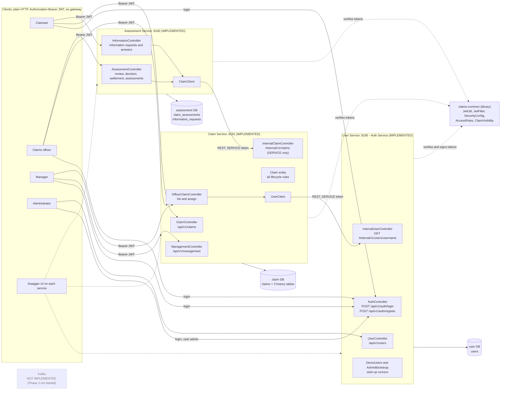
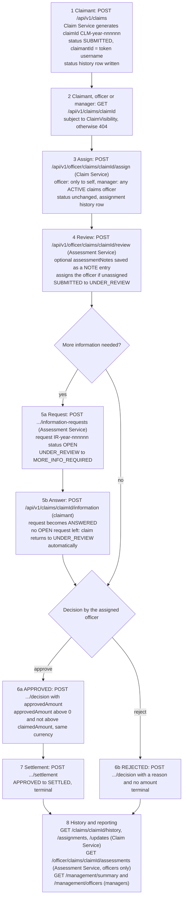
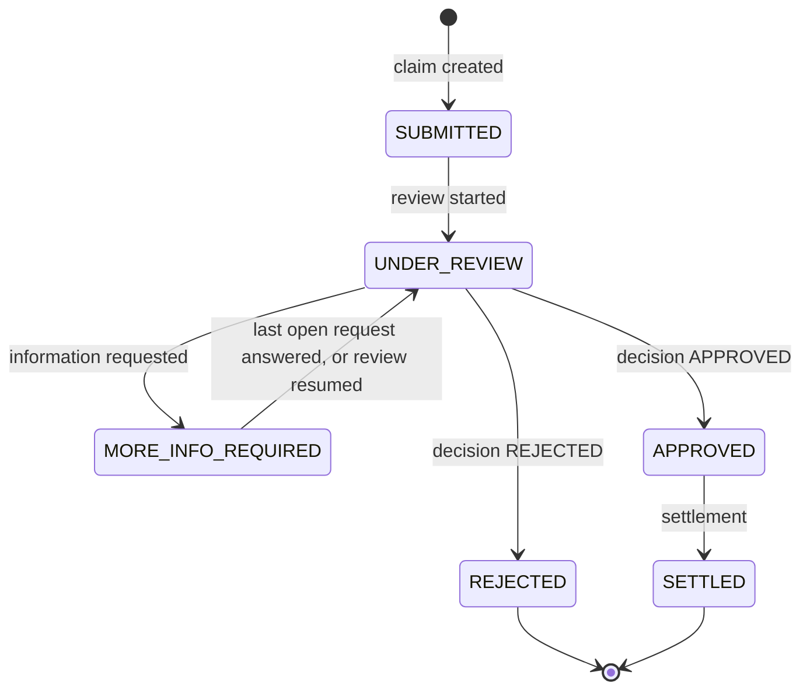
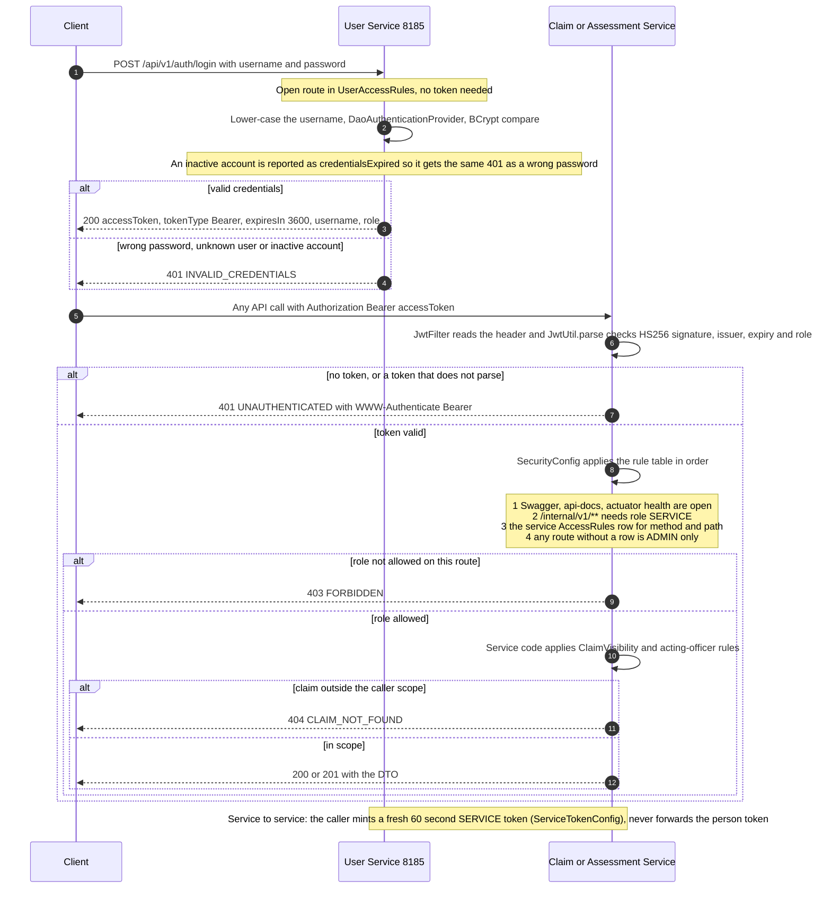
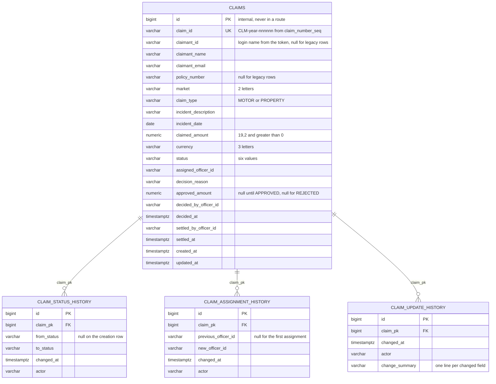
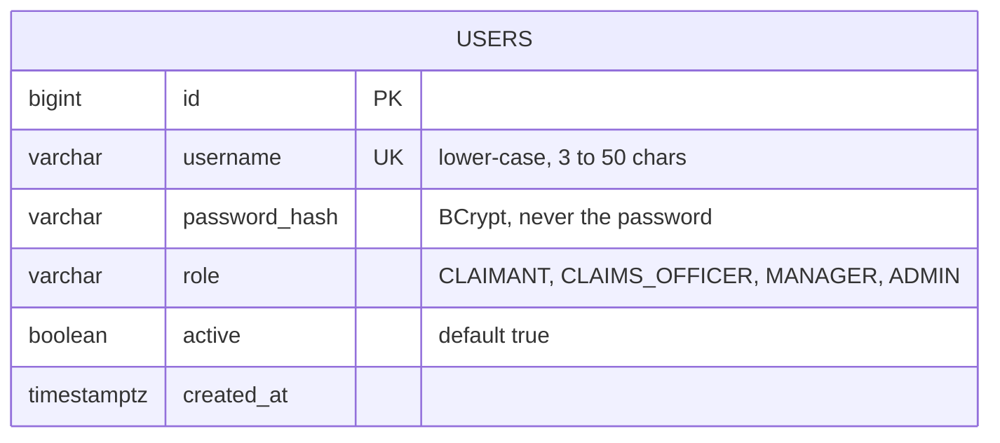
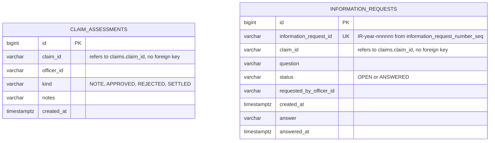
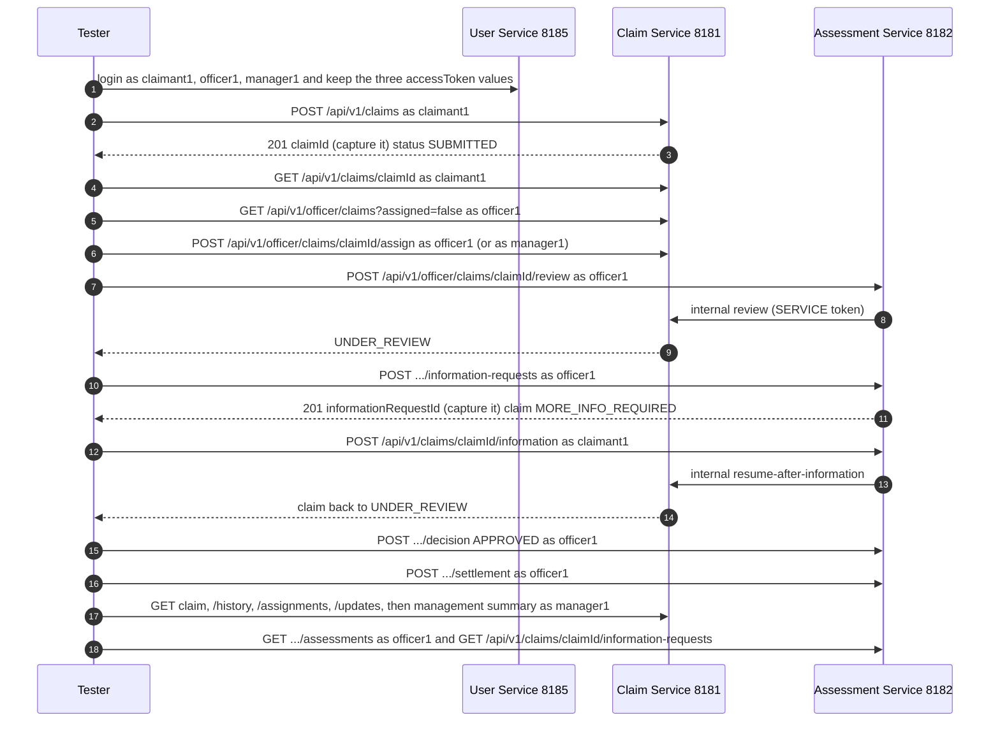

# Chubb APAC Claims Backend: Architecture

> Written on 2026-10-27 from the source code at git commit `ee90578` on branch `main`, plus a build and test run made
> in a scratch copy of the sources during the same task (section 11). Every class name, route, role, status value, port
> and property below was read from the source, not copied from the other documents. Where this file and `README.md`,
> `API_TEST_CASES.md`, `DESIGN_DECISIONS.md` or `CLAUDE.md` disagree, this file says so (section 11).
>
> **Scope of this file:** the code as committed in `ee90578`, which is what was built and run. While the task was running, the three
> services' `application.properties` were edited by someone else and then committed as `b33e4a3` (not pushed). That commit is described
> in section 11.3 and is **not** reflected anywhere else in this file, and it was not tested.
>
> **This is a demonstration system. It is not secure enough to call production-ready** (shared signing secret, demo
> users on by default, no revocation, no lockout, no TLS; section 11).

**Status labels used in this file**

| Label | Meaning |
|---|---|
| **IMPLEMENTED** | The code is in the repository and was read for this document. |
| **TESTED (this run)** | Automated tests for it were executed in this task and passed (section 11 has the totals). |
| **LIVE (this run)** | Exercised over HTTP against running jars in this task (section 11.1). |
| **JOURNAL-REPORTED** | An earlier session recorded a live check in `.claude/ai-journal.md`; it was not repeated here. |
| **PARTIAL** | Some of it exists or was checked; the gap is named. |
| **UNVERIFIED** | No evidence of it having been executed. |
| **NOT IMPLEMENTED** | Does not exist in the code. Not claimed anywhere in this file. |

---

## 1. Project overview and current implementation status

The repository holds a claims-handling backend for the Chubb APAC assessment brief: a claimant submits a claim, an
officer is assigned, reviews it (optionally asking the claimant for more information), approves or rejects it, and an
approved claim is settled; managers see workload and liability reports.

It exists twice:

| Version | Where | State |
|---|---|---|
| **Three Spring Boot microservices** (the current system) | `microservices/` | **IMPLEMENTED**. This is what the rest of this file describes. |
| **Original single application** (monolith, reference baseline) | repository root (`src/`, `pom.xml`) | **IMPLEMENTED**, no authentication, same default port 8181 as the Claim Service. Not modified by the microservice work; `CLAUDE.md` forbids changing or deleting it without being asked. |

Stack (from the POMs): Java 17, Spring Boot 3.3.5, Maven multi-module, Spring Web, Spring Data JPA, Bean Validation,
Spring Security, `jjwt` 0.12.6, Flyway, springdoc-openapi 2.6.0, `RestClient`, Actuator (health only), H2 (runtime scope,
default) and the PostgreSQL driver (runtime scope, opt-in).

### Feature status

| Capability | Status | Evidence |
|---|---|---|
| Login and JWT issue (`POST /api/v1/auth/login`), self-registration of claimants | **IMPLEMENTED**, **TESTED (this run)** | `AuthController`, `UserService`; user-service suite 62 of 62 |
| User administration (create, list, change role, activate or deactivate) | **IMPLEMENTED**, **TESTED (this run)** | `UserController`; same suite |
| JWT (HS256) verified locally by every service; role table per service (`AccessRules`) | **IMPLEMENTED**, **TESTED (this run)** | `claims-common` suite 54 of 54; the three `*SecurityTest` classes |
| Claim create, retrieve, list with filters and paging, claimant edit | **IMPLEMENTED**, **TESTED (this run)** | `ClaimController`; claim-service suite 201 of 201 |
| Officer assignment (officer to self, manager to any active claims officer) | **IMPLEMENTED**, **TESTED (this run)** | `OfficerClaimController`, `OfficerClaimService`, `UserClient` |
| Review with optional assessment notes | **IMPLEMENTED**, **TESTED (this run)** | `AssessmentController`; assessment-service suite 90 of 90 |
| Information requests and answers, text only | **IMPLEMENTED**, **TESTED (this run)** | `InformationController`. **Document or photo upload is NOT IMPLEMENTED.** |
| Decision (approve with amount, reject with reason) and settlement | **IMPLEMENTED**, **TESTED (this run)** | `AssessmentService`, `ClaimWorkflowService`, `Claim` |
| Status, assignment, edit and assessment histories | **IMPLEMENTED**, **TESTED (this run)** | four append-only tables (section 8) |
| Management reports (`/api/v1/management/summary`, `/officers`) | **IMPLEMENTED**, **TESTED (this run)** | `ManagementService` |
| Cross-service flows over real HTTP (all three services in one JVM) | **IMPLEMENTED**, **PARTIAL** | `system-tests`: 171 of 173 passed, 2 failed (section 11) |
| Start, smoke-test and stop scripts | **IMPLEMENTED**, **LIVE (this run)** | `microservices/scripts/*.ps1` on spare ports: 81 of 81 smoke checks passed (section 11.1) |
| Flyway migrations on H2 | **IMPLEMENTED**, **TESTED (this run)** | `ClaimMigrationTest`, `UserMigrationTest`, `AssessmentMigrationTest` |
| PostgreSQL | **PARTIAL**, **UNVERIFIED** for most of it | profiles exist; only Claim V1 to V4 and User V1 ran there, per the journal (Entries 14, 15); nothing was run on PostgreSQL in this task |
| Kafka, events, outbox | **NOT IMPLEMENTED**. Phase 2 has not been started. | no dependency, no configuration, no class |
| API gateway, service discovery, retries, circuit breakers | **NOT IMPLEMENTED** (deliberately) | `DESIGN_DECISIONS.md` section 2 |
| Token revocation, refresh, logout, lockout, rate limiting, TLS | **NOT IMPLEMENTED** | listed in `README.md` section 14 |

Every row above from login through the management reports was also exercised **live** in this run, through the section 10
sequence and `smoke-test.ps1` on the packaged jars (section 11.1). That run used the packaged configuration with a generated
secret; it says nothing about PostgreSQL or about the secret fallback discussed in section 11.2.

---

## 2. Actual folder structure

Only source and documentation are shown. Build output (`target/`), `.idea/` and `.git/` are omitted. The repository's
`.gitignore` excludes `target/`, `.idea/`, `.vscode/`, `*.iml`, `.env*`, `*.log`, `*.pid` and local override property files.

```text
chubb_Assessment/
├── CLAUDE.md                        development rules for humans and AI
├── README.md                        overview, setup, run, limits
├── API_TEST_CASES.md                endpoint contracts and test cases
├── DESIGN_DECISIONS.md              why it is built this way
├── design-i.docx                    the assessment brief (binary, not read by this task)
├── docs/
│   └── architecture.md              this file
├── .claude/
│   ├── ai-journal.md                original working journal (Entries 1 to 16)
│   └── AI_WORKING_JOURNAL.md        the same history plus the entry for this task
├── pom.xml, mvnw, mvnw.cmd, .mvn/   the ORIGINAL monolith build and the Maven Wrapper (Maven 3.9.9)
├── src/                             the ORIGINAL monolith (com.chubb.claims.{claim,information,management,officer,common})
│   ├── main/java/..., main/resources/{application*.properties, db/migration/V1..V4}
│   └── test/java/...                17 files, unchanged
└── microservices/
    ├── pom.xml                      parent "claims-microservices" (modules below)
    ├── scripts/                     start-all.ps1, stop-all.ps1, smoke-test.ps1
    ├── claims-common/               library, not a service
    │   └── src/main/java/com/chubb/claims/common/
    │       ├── ApiError, ApiException, DownstreamClient, GlobalExceptionHandler, OfficerIds
    │       └── security/            AccessRule, AccessRules, AuthenticatedUser, ClaimVisibility, JwtFilter,
    │                                JwtProperties, JwtUtil, RestSecurityHandlers, Role, SecurityConfig, ServiceTokenConfig
    │   (its test-jar carries the shared test helpers: TestAuth, DefaultTestTokens, AccessMatrix, RouteCoverage)
    ├── user-service/                the Auth Service            port 8185   package com.chubb.claims.user
    │   ├── UserServiceApplication, AuthController, UserController, InternalUserController, UserService,
    │   │   UserAccount, UserRepository, UserDtos, UserAccessRules, AccountUserDetailsService,
    │   │   AdminBootstrap, DemoUsers, config/{OpenApiConfig, PasswordConfig}
    │   └── resources/{application.properties, application-postgres.properties, db/migration/user/V1, V2}
    ├── claim-service/               claims, assignment, history, reports   port 8181   package com.chubb.claims.claim
    │   ├── claim/                   ClaimServiceApplication, ClaimController, ClaimService, Claim (entity and lifecycle),
    │   │                            ClaimStatus, ClaimType, ClaimRepository, ClaimSpecifications, ReferenceGenerator,
    │   │                            MarketPolicy, request/response records, the three history entities and repositories
    │   ├── claim/officer/           OfficerClaimController, OfficerClaimService, OfficerDtos
    │   ├── claim/internal/          InternalClaimController, ClaimWorkflowService, InternalDtos   (SERVICE only)
    │   ├── claim/management/        ManagementController, ManagementService, ManagementSummary, OfficerMetrics
    │   ├── claim/client/            UserClient
    │   ├── claim/config/            ClaimAccessRules, ClientConfig, OpenApiConfig
    │   └── resources/{application.properties, application-postgres.properties, db/migration/claim/V1..V5}
    ├── assessment-service/          review, information requests, decision, settlement   port 8182   package com.chubb.claims.assessment
    │   ├── assessment/              AssessmentServiceApplication, AssessmentController, AssessmentService, ActingAs,
    │   │                            AssessmentDtos, AssessmentKind, ClaimAssessment, ClaimAssessmentRepository
    │   ├── assessment/information/  InformationController, InformationService, InformationRequest (+Status, Repository,
    │   │                            ReferenceGenerator), InformationDtos
    │   ├── assessment/client/       ClaimClient
    │   ├── assessment/config/       AssessmentAccessRules, ClientConfig, OpenApiConfig
    │   └── resources/{application.properties, application-postgres.properties, db/migration/assessment/V1, V2}
    └── system-tests/                boots all three services in one JVM, drives them over real HTTP (tests only)
```

Test classes (names from the source tree, `src/test/java`):

| Module | Classes |
|---|---|
| `claims-common` | `ClaimVisibilityTest`, `DownstreamClientTest`, `GlobalExceptionHandlerTest`, `JwtUtilTest`, `SecurityChainTest` (+ helpers) |
| `user-service` | `AdminBootstrapTest`, `AuthTest`, `DemoUsersTest`, `DemoUsersUnitTest`, `UserActiveFlagTest`, `UserAdminTest`, `UserMigrationTest`, `UserSecurityTest` |
| `claim-service` | `AssignmentRulesTest`, `ClaimCreationTest`, `ClaimDomainTest`, `ClaimListTest`, `ClaimMigrationTest`, `ClaimSecurityTest`, `ClaimUpdateTest`, `ConcurrentTransitionTest`, `DefaultMarketTest`, `EndpointContractTest`, `HistoryEndpointsTest`, `InternalClaimApiTest`, `ManagementReportTest`, `MarketValidationTest`, `OfficerSearchTest`, `UnassignedFilterTest`, `UserClientTest` |
| `assessment-service` | `ActingAsTest`, `AssessmentContractTest`, `AssessmentMigrationTest`, `AssessmentSecurityTest`, `AssessmentServiceTest`, `InformationRequestTest` |
| `system-tests` | `AssessmentNotesTest`, `AssignmentHistoryTest`, `AuthenticationFlowTest`, `ClaimCreationTest`, `ClaimWorkflowTest`, `ConcurrentTransitionTest`, `CurrencyHandlingTest`, `DatabasePerServiceConfigurationTest`, `DemoFlowTest`, `DemoUsersFlowTest`, `EndpointContractTest`, `JwtSecretConfigurationTest`, `ManagementSummaryTest`, `OfficerMetricsTest`, `OfficerSearchTest`, `PlaceholderActorTest`, `ServiceBoundariesTest`, `ServiceFailureTest`, `StatusHistoryTest`, `UnassignedFilterTest` (+ harness `HttpMvc`, `SystemUnderTest`, `SystemJdbc`) |

---

## 3. Current architecture and responsibilities

Three applications, each with its own database, calling each other over synchronous REST. There is no gateway: a
client talks to the service that owns the route (the User Service for login, the Claim Service for claims, the
Assessment Service for review work). Every service checks the JWT itself with the same shared secret and never asks the
User Service whether a token is valid.

| Module | Port | Package | Owns (tables) | Responsibility | Calls |
|---|---|---|---|---|---|
| `claims-common` | none | `com.chubb.claims.common`, `.security` | none | Error model (`ApiError`, `ApiException`, `GlobalExceptionHandler`), `DownstreamClient`, the JWT chain (`JwtUtil`, `JwtFilter`, `SecurityConfig`, `AccessRules`), `ClaimVisibility`, `Role`, `AuthenticatedUser`. No domain code, no database. | n/a |
| `user-service` (Auth Service) | 8185 | `com.chubb.claims.user` | `users` | Login, token issue, registration, user and role management, active flag, demo users, optional bootstrap administrator, the officer lookup for other services | nobody |
| `claim-service` | 8181 | `com.chubb.claims.claim` | `claims`, `claim_status_history`, `claim_assignment_history`, `claim_update_history`, sequence `claim_number_seq` | The claim record and **every lifecycle rule** (inside the `Claim` entity), creation, listing, claimant edits, assignment, the three histories, decision and settlement rules, management reports | `user-service` only, to check that a manager's chosen assignee is an active claims officer |
| `assessment-service` | 8182 | `com.chubb.claims.assessment` | `claim_assessments`, `information_requests`, sequence `information_request_number_seq` | Review with notes, assessment history, information requests and answers, decision, settlement | `claim-service` |
| `system-tests` | random | `com.chubb.claims.system` | in-memory H2 per service | Boots the three services in one JVM and drives them over HTTP | n/a |

Rules the code enforces:

* **The dependency graph is fixed and acyclic:** Assessment calls Claim, Claim calls User, User calls nobody, nobody calls
  Assessment. A fact that would need a call back is passed in the request instead (`hasOpenInformationRequests` on the
  review command).
* **Lifecycle rules live in `Claim`** (`startReview`, `requestInformation`, `resumeAfterInformation`, `decide`, `settle`,
  `updateDetails`), run under a pessimistic row lock (`ClaimRepository.findByClaimIdForUpdate`, `@Lock(PESSIMISTIC_WRITE)`)
  in one local transaction inside the Claim Service. Other services never change a claim directly.
* **Service-to-service calls** go through one client class each (`ClaimClient`, `UserClient`) built on `DownstreamClient`
  and carry a fresh 60-second `SERVICE` token (`ServiceTokenConfig`). A person's token is never forwarded. A refused or
  unreachable peer becomes 503 `DOWNSTREAM_UNAVAILABLE` or 502 `DOWNSTREAM_ERROR`; there are no retries.
* **Who may see which claim** is one class, `ClaimVisibility`: a claimant only claims they submitted, a claims officer only
  unassigned claims and claims assigned to them, a manager and an administrator every claim. A claim outside that scope
  answers exactly like an unknown claim (404 `CLAIM_NOT_FOUND`). In the Claim Service the same rule is also applied as SQL
  (`ClaimSpecifications.visibleTo`) so lists cannot show what a single read would hide.
* **Cross-service consistency is best effort.** The Assessment Service writes its own history row, calls the Claim
  Service before committing, and rolls back if the Claim Service refuses or is down. If its own commit fails after the
  Claim Service accepted, the claim has moved without its entry. This is not a distributed transaction.

---

## 4. Architecture flowchart



How to read it: solid arrows are HTTP calls, dashed arrows are library use or the (unauthenticated) Swagger pages.
Each database is private to its service; no service reads another's tables. All three default to an in-memory H2
database and can be pointed at PostgreSQL with environment variables (section 9).

---

## 5. Claim workflow

### Flow through the services



Notes taken from the code:

* Step 3 is optional: step 4 assigns an unassigned claim to the reviewing officer. If an administrator reviews on an
  officer's behalf, the Claim Service additionally checks that the named officer is an active claims officer.
* Review can also resume from `MORE_INFO_REQUIRED` explicitly, but only when no information request is `OPEN`.
* Assigned-officer rule: request-information, decision and settlement fail with 409 `OFFICER_MISMATCH` if another officer holds the claim.
* A claimant can correct their own claim with `PATCH /api/v1/claims/{claimId}` only while it is `SUBMITTED` (409 `CLAIM_NOT_EDITABLE` afterwards); each edit that changes something is recorded in `claim_update_history`.

### Status transitions



---

## 6. Login and JWT authorization flow



Facts behind the diagram:

* Roles (`Role` enum): `CLAIMANT`, `CLAIMS_OFFICER`, `MANAGER`, `ADMIN` for people; `SERVICE` for service-to-service, never storable for a user (`JwtUtil.generate` refuses it, `AccessRule.roles` rejects it).
* `AccessRule.roles(...)` always adds `ADMIN`, so an administrator may call every public route. There is no role hierarchy.
* Token content: subject (username), `role`, issuer (default `chubb-claims`), issued-at, expiry. Algorithm HS256 only; a token with no expiry or another algorithm is refused. Lifetime of a login token is `claims.security.jwt.expiry` (default 60 minutes); service tokens 60 seconds. Clock skew tolerance 30 seconds.
* Secret: at least 32 bytes, shared by all three services, read from `claims.security.jwt.secret` (environment variable `JWT_SECRET`). `JwtUtil` stops the service at start-up if the value is missing or shorter. **See section 11.2 for a discrepancy about a fallback value in the packaged properties.**
* `/actuator/health` shows only UP or DOWN, with no details.
* A deactivated user cannot log in again; a token already issued keeps working until it expires (no revocation).

---

## 7. REST API reference

Source: the `@RestController` classes and the three `*AccessRules` classes. "ADMIN" is implied in every role column of a
public route (see section 6). Request fields marked `?` are optional. Errors always use the body
`{timestamp, status, error, code, message, path}` (`ApiError`).

Success statuses and error codes below come from the controller annotations and the code that throws them. They were
exercised by the automated tests listed in section 2 (section 11 has the results); the request bodies in section 10 were
also run against live jars (section 11).

### 7.1 User Service, base `http://localhost:8185`

| Method | Path | Purpose | Roles | Request | Response |
|---|---|---|---|---|---|
| POST | `/api/v1/auth/login` | Exchange credentials for a JWT | none (open) | `username` (required, max 100), `password` (required, max 128) | 200 `{accessToken, tokenType, expiresIn, username, role}`; 400 `VALIDATION_FAILED` / `MALFORMED_REQUEST`; 401 `INVALID_CREDENTIALS` |
| POST | `/api/v1/auth/register` | Create a CLAIMANT account (any `role` in the body is ignored) | none (open) | `username` (3 to 50 chars, lower-case letters, digits, `.` `_` `-`, starts with letter or digit), `password` (8 to 72 chars and at most 72 bytes) | 201 `{username, role, active, createdAt}`; 400 `VALIDATION_FAILED` / `PASSWORD_TOO_LONG`; 409 `USERNAME_TAKEN` |
| GET | `/api/v1/users/me` | The caller's own account | CLAIMANT, CLAIMS_OFFICER, MANAGER, ADMIN | none | 200 `{username, role, active, createdAt}` |
| POST | `/api/v1/users` | Create a user with any person role | ADMIN | `username`, `password` (as above), `role` (`CLAIMANT`, `CLAIMS_OFFICER`, `MANAGER`, `ADMIN`) | 201 user; 400 `INVALID_ROLE` / `VALIDATION_FAILED`; 409 `USERNAME_TAKEN` |
| GET | `/api/v1/users` | List users, ordered by username | ADMIN | query `page` (>= 0, default 0), `size` (1 to 100, default 20) | 200 `{content, page, size, totalElements, totalPages}` |
| GET | `/api/v1/users/{username}` | One user | ADMIN | none | 200 user; 404 `USER_NOT_FOUND` |
| PUT | `/api/v1/users/{username}/role` | Change a role | ADMIN | `role` | 200 user; 404; 409 `CANNOT_CHANGE_OWN_ROLE` |
| PUT | `/api/v1/users/{username}/active` | Switch an account on or off | ADMIN | `active` (boolean, required) | 200 user; 404; 409 `CANNOT_DEACTIVATE_SELF` |
| GET | `/internal/v1/users/{username}` | Role and active flag, for the Claim Service | SERVICE only | none | 200 `{username, role, active}`; 404 `USER_NOT_FOUND`; any person token gets 403 |

### 7.2 Claim Service, base `http://localhost:8181`

| Method | Path | Purpose | Roles | Request | Response |
|---|---|---|---|---|---|
| POST | `/api/v1/claims` | Submit a claim. `claimId` and `claimantId` are never taken from the body. | CLAIMANT | `claimantName` (max 200), `claimantEmail` (valid e-mail, max 254), `policyNumber` (3 to 50 chars, letters, digits, `/` `_` `-`), `market` (2 upper-case letters; checked against `claims.markets.allowed` only when that is set), `claimType` (`MOTOR` or `PROPERTY`), `incidentDescription` (max 2000), `incidentDate` (today or earlier), `claimedAmount` (> 0, at most 2 decimals), `currency` (3 upper-case letters). All required. | 201 `ClaimResponse`; 400 `VALIDATION_FAILED` / `INVALID_MARKET` / `MALFORMED_REQUEST` |
| GET | `/api/v1/claims` | List claims the caller may see, newest first | CLAIMANT (own), CLAIMS_OFFICER (queue and own), MANAGER (all) | query `status`, `market`, `claimType`, `assignedOfficerId`, `assigned` (true or false), `page` (>= 0, default 0), `size` (1 to 100, default 20) | 200 `{content: [ClaimSummary], page, size, totalElements, totalPages}`; 400 `CONFLICTING_FILTERS` (`assigned=false` with `assignedOfficerId`) / `INVALID_PARAMETER` / `VALIDATION_FAILED` |
| GET | `/api/v1/claims/{claimId}` | One claim | CLAIMANT (own), CLAIMS_OFFICER, MANAGER | none | 200 `ClaimResponse`; 404 `CLAIM_NOT_FOUND` (also for a claim out of scope) |
| PATCH | `/api/v1/claims/{claimId}` | Correct your own claim while `SUBMITTED` | CLAIMANT (owner) | any of `claimantName`, `claimantEmail`, `policyNumber`, `claimType`, `incidentDescription`, `incidentDate`, `claimedAmount`; at least one. Not changeable: `market`, `currency`, status, assignment. | 200 `ClaimResponse`; 400 `NO_FIELDS_TO_UPDATE` / `VALIDATION_FAILED`; 404; 409 `CLAIM_NOT_EDITABLE` |
| GET | `/api/v1/claims/{claimId}/history` | Status changes | CLAIMANT (own), CLAIMS_OFFICER, MANAGER | none | 200 `[{claimId, fromStatus, toStatus, changedAt, actor}]` (first row has `fromStatus` null); 404 |
| GET | `/api/v1/claims/{claimId}/assignments` | Assignee changes | CLAIMANT (own), CLAIMS_OFFICER, MANAGER | none | 200 `[{claimId, previousOfficerId, newOfficerId, changedAt, actor}]`; 404 |
| GET | `/api/v1/claims/{claimId}/updates` | The claimant's edits | CLAIMANT (own), CLAIMS_OFFICER, MANAGER | none | 200 `[{claimId, changedAt, actor, changes}]` (free text is recorded as "changed"); 404 |
| GET | `/api/v1/officer/claims` | Staff view of the same list | CLAIMS_OFFICER, MANAGER | same query as `GET /api/v1/claims` | 200 page of `ClaimSummary` |
| POST | `/api/v1/officer/claims/{claimId}/assign` | Assign a claim | CLAIMS_OFFICER (only to themselves), MANAGER (any active claims officer) | `officerId` (required, max 50, not the placeholder `string`) | 200 `{claimId, status, assignedOfficerId, updatedAt}`; 400 `INVALID_OFFICER`; 403 `ASSIGNMENT_NOT_PERMITTED`; 404; 409 `INVALID_CLAIM_TRANSITION` (settled or rejected claim); 503 `DOWNSTREAM_UNAVAILABLE` (User Service down) |
| GET | `/api/v1/management/summary` | Counts per status and outstanding liability per currency | MANAGER | none | 200 `{generatedAt, liabilityNote, outstandingClaimCount, outstandingLiabilityByCurrency: [{currency, claimCount, estimatedLiability}], countsByStatus}` |
| GET | `/api/v1/management/officers` | Open workload and decisions per officer | MANAGER | none | 200 `{generatedAt, note, officers: [{officerId, openClaimCount, openClaimsByStatus, openClaimedAmountByCurrency, decidedCount, approvedCount, settledCount, rejectedCount, approvedAmountByCurrency}]}` |

`ClaimResponse` fields: `id` (internal key), `claimId`, `claimantId`, `claimantName`, `claimantEmail`, `policyNumber`,
`market`, `claimType`, `incidentDescription`, `incidentDate`, `claimedAmount`, `approvedAmount`, `currency`, `status`,
`assignedOfficerId`, `decisionReason`, `decidedAt`, `settledAt`, `createdAt`, `updatedAt`. `ClaimSummary` carries
`id`, `claimId`, `claimantId`, `claimantName`, `policyNumber`, `market`, `claimType`, `claimedAmount`, `approvedAmount`,
`currency`, `status`, `assignedOfficerId`, `createdAt`. Assessment notes are never part of either.

Internal routes (`/internal/v1/claims/...`, **SERVICE token only**, called by the Assessment Service; a person's token,
an administrator's included, gets 403):

| Method | Path | Purpose | Request | Response |
|---|---|---|---|---|
| GET | `/internal/v1/claims/{claimId}/status` | Status, submitter and assignee, no claimant data | none | 200 `{claimId, status, claimantId, assignedOfficerId}`; 404 `CLAIM_NOT_FOUND` |
| POST | `/internal/v1/claims/{claimId}/review` | `SUBMITTED` or `MORE_INFO_REQUIRED` to `UNDER_REVIEW` | `officerId`, `hasOpenInformationRequests`, `officerVerified?` | 200 workflow response; 400 `INVALID_OFFICER`; 409 `INVALID_CLAIM_TRANSITION` / `OFFICER_MISMATCH` |
| POST | `/internal/v1/claims/{claimId}/request-information` | `UNDER_REVIEW` to `MORE_INFO_REQUIRED` | `requestedByOfficerId` | 200; 409 |
| POST | `/internal/v1/claims/{claimId}/resume-after-information` | `MORE_INFO_REQUIRED` to `UNDER_REVIEW` | `answeredBy?` | 200; 409 |
| POST | `/internal/v1/claims/{claimId}/decision` | `UNDER_REVIEW` to `APPROVED` or `REJECTED` with the amount and currency rules | `decision`, `decisionReason`, `approvedAmount?`, `currency`, `decidedByOfficerId` | 200 `{claimId, status, decisionReason, approvedAmount, currency, decidedByOfficerId, decidedAt, updatedAt}`; 400 `CURRENCY_MISMATCH` / `INVALID_APPROVED_AMOUNT`; 409 |
| POST | `/internal/v1/claims/{claimId}/settlement` | `APPROVED` to `SETTLED` | `settledByOfficerId` | 200 `{claimId, status, approvedAmount, currency, settledByOfficerId, settledAt, updatedAt}`; 409 |

### 7.3 Assessment Service, base `http://localhost:8182`

| Method | Path | Purpose | Roles | Request | Response |
|---|---|---|---|---|---|
| POST | `/api/v1/officer/claims/{claimId}/review` | Start or resume review | CLAIMS_OFFICER (ADMIN must name the officer) | `officerId?`, `assessmentNotes?` (max 2000; blank saves nothing) | 200 `{claimId, status, assignedOfficerId, updatedAt}`; 403 `OFFICER_IDENTITY_MISMATCH`; 404; 409 `INVALID_CLAIM_TRANSITION` / `OFFICER_MISMATCH`; 502 / 503 downstream |
| GET | `/api/v1/officer/claims/{claimId}/assessments` | Assessment history, oldest first. Never shown to claimants; managers cannot read it either. | CLAIMS_OFFICER | none | 200 `[{claimId, officerId, kind, notes, createdAt}]`, `kind` is `NOTE`, `APPROVED`, `REJECTED` or `SETTLED`; 404 |
| POST | `/api/v1/officer/claims/{claimId}/information-requests` | Ask the claimant for information | CLAIMS_OFFICER | `question` (required, max 2000), `requestedByOfficerId?` | **201** `{informationRequestId, claimId, question, status, requestedByOfficerId, createdAt, answer, answeredAt}`; 404; 409 |
| GET | `/api/v1/claims/{claimId}/information-requests` | Requests and answers for a claim | CLAIMANT (own), CLAIMS_OFFICER, MANAGER | none | 200 list; 404 |
| POST | `/api/v1/claims/{claimId}/information` | Answer a request. When the last open one is answered the claim returns to `UNDER_REVIEW` by itself. | CLAIMANT | `informationRequestId` (required), `answer` (required, max 4000) | 200 `{informationRequestId, claimId, status, answer, answeredAt}`; 404 `CLAIM_NOT_FOUND` / `INFORMATION_REQUEST_NOT_FOUND`; 409 `INVALID_CLAIM_TRANSITION` / `INFORMATION_REQUEST_ALREADY_ANSWERED` |
| POST | `/api/v1/officer/claims/{claimId}/decision` | Approve or reject | CLAIMS_OFFICER (assigned officer) | `decision` (`APPROVED` or `REJECTED`), `decisionReason` (required, max 2000), `approvedAmount?` (required and > 0 and <= claimed for an approval, absent for a rejection), `currency` (must equal the claim's), `decidedByOfficerId?` | 200 decision response; 400 `CURRENCY_MISMATCH` / `INVALID_APPROVED_AMOUNT`; 404; 409 (second decision keeps the first) |
| POST | `/api/v1/officer/claims/{claimId}/settlement` | Settle an approved claim | CLAIMS_OFFICER (assigned officer) | `settledByOfficerId?`, `settlementNote?` (max 2000) | 200 settlement response; 404; 409 (a rejected claim can never be settled) |

Role rules shared by the officer routes: a claims officer always acts as the token's user. They may omit the officer ID or
repeat their own name; naming another officer is 403 `OFFICER_IDENTITY_MISMATCH`. An administrator acting for an officer
must name one (400 `VALIDATION_FAILED` otherwise); the history then shows that officer, and `ActingAs` writes one log
line naming the administrator.

### 7.4 Error codes and statuses

| Status | Codes |
|---|---|
| 400 | `VALIDATION_FAILED`, `MALFORMED_REQUEST`, `INVALID_PARAMETER`, `INVALID_MARKET`, `CONFLICTING_FILTERS`, `NO_FIELDS_TO_UPDATE`, `INVALID_OFFICER`, `INVALID_ROLE`, `PASSWORD_TOO_LONG`, `CURRENCY_MISMATCH`, `INVALID_APPROVED_AMOUNT` |
| 401 | `UNAUTHENTICATED` (no usable token), `INVALID_CREDENTIALS` (login, also for a deactivated user) |
| 403 | `FORBIDDEN` (role not allowed on the route, from the security chain), `OFFICER_IDENTITY_MISMATCH`, `ASSIGNMENT_NOT_PERMITTED` |
| 404 | `CLAIM_NOT_FOUND` (unknown claim or one outside the caller's scope), `INFORMATION_REQUEST_NOT_FOUND`, `USER_NOT_FOUND`, `NOT_FOUND` |
| 405, 415 | `METHOD_NOT_ALLOWED`, `UNSUPPORTED_MEDIA_TYPE` |
| 409 | `INVALID_CLAIM_TRANSITION`, `OFFICER_MISMATCH`, `CLAIM_NOT_EDITABLE`, `INFORMATION_REQUEST_ALREADY_ANSWERED`, `USERNAME_TAKEN`, `CANNOT_CHANGE_OWN_ROLE`, `CANNOT_DEACTIVATE_SELF` |
| 500 | `INTERNAL_ERROR` (no stack trace in the body) |
| 502, 503 | `DOWNSTREAM_ERROR`, `DOWNSTREAM_UNAVAILABLE` |

---

## 8. Data model

Each service owns its schema. Flyway owns the DDL (`spring.flyway.locations` per service) and Hibernate only validates
(`spring.jpa.hibernate.ddl-auto=validate`). SQL is kept valid for both H2 (PostgreSQL mode) and PostgreSQL.

### 8.1 Entities and tables







**Relationships.** Inside the Claim database the three history tables have a real foreign key to `claims.id`. Across
services there is **no foreign key and no shared table**: the Assessment tables point to a claim by the public
`claim_id` text only, and the Claim Service is asked whether a claim exists. The `users` table is read by nobody except
the User Service.

**Migrations (Flyway):**

| Service | Versions | What they do |
|---|---|---|
| Claim (`db/migration/claim`) | V1 to V5 | V1 `claims` and `claim_number_seq` (starts at 101); V2 status history; V3 assignment history; V4 `created_by`; V5 the Phase 1 model: status `AWAITING_INFORMATION` renamed `MORE_INFO_REQUIRED`, `APPROVED` added, columns renamed (`description` to `incident_description`, `settled_amount` to `approved_amount`, `created_by` to `claimant_id`), `policy_number`, `settled_by_officer_id`, `settled_at`, `claim_update_history` |
| User (`db/migration/user`) | V1, V2 | V1 `users`; V2 role `OFFICER` renamed `CLAIMS_OFFICER`, `active` flag |
| Assessment (`db/migration/assessment`) | V1, V2 | V1 `claim_assessments`; V2 `kind` column, `information_requests` and its sequence |

An applied migration is never edited. Claim V5, User V2 and Assessment V2 change stored data and have tests that run
them over pre-existing rows on H2.

### 8.2 Identity, policy, currency and amounts

| Concept | Implementation |
|---|---|
| Internal key `id` | `BIGINT` identity column. It appears in `ClaimResponse` and `ClaimSummary` bodies but is never accepted in a route. |
| `claimId` (public reference) | `CLM-<year>-<6 digits>`, built by `ReferenceGenerator` from `select nextval('claim_number_seq')`, generated server-side, unique (`uq_claims_claim_id`), never supplied by the client. The first value on a fresh database is `CLM-<year>-000101`. The year is only a prefix; the number keeps rising across years. |
| `informationRequestId` | `IR-<year>-<6 digits>` from `information_request_number_seq` (starts at 1), unique. Refers to its claim by `claimId`. |
| `claimantId` | The logged-in claimant's **login name**, taken from the token when the claim is created, never from the body. A claim with no recorded owner (legacy) is never a claimant's. |
| `claimantName` | Free text the claimant types (max 200). Separate from `claimantId`. |
| `policyNumber` | Free text the claimant types: 3 to 50 characters, letters, digits, `/`, `_`, `-`, starting with a letter or digit. Only the characters are checked; the insurer's own format is not known. Required for every new claim; null only on legacy rows. |
| `market` | 2 upper-case letters. The six APAC markets are not named in the brief, so no list is built in; `claims.markets.allowed` (empty by default) is the only switch. |
| `currency` | 3 upper-case letters, required, stored with the claim. The API does not restrict it to a list. A decision must use the claim's currency (400 `CURRENCY_MISMATCH`). Reports group by currency and never add different currencies or convert. |
| `claimedAmount` | `BigDecimal`, scale 2, greater than 0 (also a database `CHECK`). |
| `approvedAmount` | Null until a claim is approved; must be greater than 0 and at most `claimedAmount` (400 `INVALID_APPROVED_AMOUNT`); stays null for a rejected claim, which must not carry one. |

### 8.3 Status transitions (enforced in `Claim`)

| Action | Allowed from | Result | Who |
|---|---|---|---|
| create | none | `SUBMITTED`, history row `null` to `SUBMITTED` | claimant |
| assign | any status except `SETTLED` and `REJECTED` | status unchanged, assignee set | officer (self) or manager |
| review | `SUBMITTED`; `MORE_INFO_REQUIRED` only when no request is `OPEN` | `UNDER_REVIEW`, assignee set if empty; 409 `OFFICER_MISMATCH` if another officer holds it | claims officer |
| request information | `UNDER_REVIEW` | `MORE_INFO_REQUIRED`, request `OPEN` | the assigned officer |
| answer | `MORE_INFO_REQUIRED` | request `ANSWERED`; claim returns to `UNDER_REVIEW` when no `OPEN` request remains | claimant |
| approve | `UNDER_REVIEW` | `APPROVED`, `approvedAmount`, `decisionReason`, `decidedByOfficerId`, `decidedAt` set | the assigned officer |
| reject | `UNDER_REVIEW` | `REJECTED`, reason kept, no amount | the assigned officer |
| settle | `APPROVED` | `SETTLED`, `settledByOfficerId`, `settledAt` set | the assigned officer |
| claimant edit | `SUBMITTED` | details changed, edit recorded; otherwise 409 `CLAIM_NOT_EDITABLE` | the owning claimant |

`REJECTED` and `SETTLED` are terminal (`ClaimStatus.isTerminal`); `APPROVED` is not. Any other move is 409
`INVALID_CLAIM_TRANSITION`.

Reports (`ManagementService`): the summary counts every claim that is not `SETTLED` or `REJECTED`, groups liability by
currency, counts an `APPROVED` claim at its approved amount and any other open claim at its claimed amount, and labels
the figure a simple estimate that is not a reserve. The officer report groups open claims by current assignee and
decisions by deciding officer.

---

## 9. Configuration, ports and start-up

### 9.1 Ports, URLs and Swagger

| Service | Port | API base | Swagger UI | OpenAPI JSON | Health |
|---|---|---|---|---|---|
| User | 8185 | `http://localhost:8185` | `/swagger-ui/index.html` | `/v3/api-docs` | `/actuator/health` |
| Claim | 8181 | `http://localhost:8181` | `/swagger-ui/index.html` | `/v3/api-docs` | `/actuator/health` |
| Assessment | 8182 | `http://localhost:8182` | `/swagger-ui/index.html` | `/v3/api-docs` | `/actuator/health` |

`springdoc.swagger-ui.path=/swagger-ui.html` is set in each service and redirects to the UI. Each service documents only
its own routes. Swagger, `/v3/api-docs` and `/actuator/health` need no token. The default port of the Claim Service is 8181,
which the original monolith also uses: do not start both at once on defaults.

### 9.2 Properties and environment variables

Defaults are in `src/main/resources/application.properties` of each service, **as committed in `ee90578`** (the later
commit `b33e4a3`, section 11.3, changes the datasource lines). Values below are placeholders where a value would be secret; **no secret
or password value is reproduced in this file.**

| Property | Environment variable | Service | Default in the file |
|---|---|---|---|
| `server.port` | `SERVER_PORT` or `--server.port` | each | 8185 / 8181 / 8182 |
| `spring.datasource.url` | `USER_DB_URL`, `CLAIM_DB_URL`, `ASSESSMENT_DB_URL` | each its own | in-memory H2 (`userdb`, `claimdb`, `assessmentdb`; PostgreSQL mode, `LOCK_TIMEOUT=10000`) |
| `spring.datasource.username` / `.password` | `*_DB_USERNAME`, `*_DB_PASSWORD` | each | `sa` and empty |
| `claims.security.jwt.secret` | `JWT_SECRET` | **all three, same value, at least 32 characters** | **a literal fallback is packaged: see section 11.2** |
| `claims.security.jwt.expiry` | `JWT_EXPIRY` | User | `60m` |
| `claims.auth.demo-users.enabled` / `.password` | `DEMO_USERS`, `DEMO_USERS_PASSWORD` | User | `true` and the documented public demo password |
| `claims.auth.bootstrap-admin.username` / `.password` | `BOOTSTRAP_ADMIN_USERNAME`, `BOOTSTRAP_ADMIN_PASSWORD` | User | empty (no extra administrator) |
| `claims.services.user.url` | `USER_SERVICE_URL` | Claim | `http://localhost:8185` |
| `claims.services.claim.url` | `CLAIM_SERVICE_URL` | Assessment | `http://localhost:8181` |
| `claims.downstream.connect-timeout` / `.read-timeout` | none | Claim, Assessment | `2s` / `10s` |
| `claims.markets.allowed` | none | Claim | empty (any 2-letter market) |
| `management.endpoints.web.exposure.include` | none | each | `health` only, no details |
| `spring.jpa.hibernate.ddl-auto` | none | each | `validate` (must stay) |

PostgreSQL is opt-in per service with `--spring.profiles.active=postgres` (`application-postgres.properties` reads only
environment variables; database names `user_db`, `claim_db`, `assessment_db`). **One database per service**: two services in
one database fail with a Flyway "checksum mismatch for migration version 1". `DatabasePerServiceConfigurationTest` guards the
default URLs.

**Demo users (demo only).** With `DEMO_USERS` unset or `true`, `DemoUsers` creates four accounts if missing:
`admin1` (ADMIN), `officer1` (CLAIMS_OFFICER), `manager1` (MANAGER), `claimant1` (CLAIMANT), all with the documented public
demo password. This makes the system a demo, not a secure deployment; set `DEMO_USERS=false` for anything else. The
password is never logged and an existing user is never reset.

### 9.3 Build and start

Run from the repository root, Java 17, Maven Wrapper:

```powershell
.\mvnw.cmd -f microservices/pom.xml clean test              # all modules, H2, no database install
.\mvnw.cmd -f microservices/pom.xml -DskipTests package     # runnable jars: microservices\<service>\target\<service>-0.0.1-SNAPSHOT-exec.jar
.\microservices\scripts\start-all.ps1 -SkipBuild            # start user, claim, assessment in that order
.\microservices\scripts\smoke-test.ps1                      # demo flow as real users
.\microservices\scripts\stop-all.ps1                        # stops only what start-all.ps1 started
.\mvnw.cmd test                                             # the original monolith (root)
```

* `start-all.ps1` parameters: `-UserPort`, `-ClaimPort`, `-AssessmentPort`, `-SkipBuild`. It refuses a busy port, uses your
  `JWT_SECRET` if set, otherwise generates a random one for that run (never printed or saved), points Claim at the User port
  and Assessment at the Claim port, and waits for each `/actuator/health`.
* By hand, one terminal per service in the order User, Claim, Assessment, with the **same** `JWT_SECRET` in each:
  `java -jar microservices\<service>\target\<service>-0.0.1-SNAPSHOT-exec.jar`.
* **Do not run `clean` while a service runs from the IDE**: it deletes that module's `target/classes` under the running
  process. After changing `claims-common`, install it (`-pl claims-common -am install`) or build with `-am`; otherwise a
  module compiles against a stale jar in `~/.m2` ("cannot find symbol" for `ClaimVisibility` / `Role.CLAIMS_OFFICER`).
* In PowerShell, quote `-D` options that contain a dot.

---

## 10. API testing sequence

Dependent requests, in order. Each step uses what the previous one returned. Ports are the defaults; use the ones you
started. The demo users exist only while `DEMO_USERS` is on.



PowerShell (Windows PowerShell 5.1 compatible). The password below is the **documented public demo password**, not a
secret; replace it if you set `DEMO_USERS_PASSWORD`.

```powershell
$user = 'http://localhost:8185'; $claim = 'http://localhost:8181'; $assess = 'http://localhost:8182'
$demoPassword = 'password123'   # documented public demo password (DEMO_USERS=true)

function Login($name) {
    $r = Invoke-RestMethod -Method Post -Uri "$user/api/v1/auth/login" -ContentType 'application/json' `
        -Body (@{ username = $name; password = $demoPassword } | ConvertTo-Json)
    @{ Authorization = "Bearer $($r.accessToken)" }
}
function Call($method, $uri, $headers, $body) {
    if ($null -ne $body) {
        Invoke-RestMethod -Method $method -Uri $uri -Headers $headers -ContentType 'application/json' -Body ($body | ConvertTo-Json -Depth 5)
    } else {
        Invoke-RestMethod -Method $method -Uri $uri -Headers $headers
    }
}
function StatusOf($method, $uri, $headers, $body) {      # the HTTP status of a call that is expected to fail
    try { Call $method $uri $headers $body | Out-Null; 200 } catch { [int]$_.Exception.Response.StatusCode }
}

# 0. health, no token needed (expect status UP on each)
(Invoke-RestMethod "$user/actuator/health").status; (Invoke-RestMethod "$claim/actuator/health").status; (Invoke-RestMethod "$assess/actuator/health").status

# 1. log in, keep the tokens
$claimant = Login 'claimant1'; $officer = Login 'officer1'; $manager = Login 'manager1'

# 2. create a claim as the claimant and capture the generated claimId
$new = Call Post "$claim/api/v1/claims" $claimant @{
    claimantName = 'Asha Rao'; claimantEmail = 'asha@example.com'; policyNumber = 'POL-1001'; market = 'SG'
    claimType = 'MOTOR'; incidentDescription = 'Rear-ended at a junction'
    incidentDate = (Get-Date).AddDays(-7).ToString('yyyy-MM-dd'); claimedAmount = 2500.00; currency = 'INR' }
$claimId = $new.claimId            # CLM-<year>-<6 digits>, status SUBMITTED, claimantId claimant1
$new.status

# 3. retrieve it, and find it in the officer's queue
(Call Get "$claim/api/v1/claims/$claimId" $claimant).status
(Call Get "$claim/api/v1/officer/claims?assigned=false" $officer).content | Where-Object claimId -eq $claimId | Select-Object claimId, status

# 4. assign (an officer can only take it for themselves; a manager could name any active officer)
Call Post "$claim/api/v1/officer/claims/$claimId/assign" $officer @{ officerId = 'officer1' }

# 5. start the review with a note (Assessment Service); status becomes UNDER_REVIEW
Call Post "$assess/api/v1/officer/claims/$claimId/review" $officer @{ assessmentNotes = 'Photos and police report requested' }

# 6. ask the claimant for information and capture the request id; status becomes MORE_INFO_REQUIRED
$ir = Call Post "$assess/api/v1/officer/claims/$claimId/information-requests" $officer @{ question = 'Please send the repair estimate' }
$irId = $ir.informationRequestId   # IR-<year>-<6 digits>
(Call Get "$claim/api/v1/claims/$claimId" $officer).status

# 7. the claimant answers; with no OPEN request left the claim returns to UNDER_REVIEW by itself
Call Post "$assess/api/v1/claims/$claimId/information" $claimant @{ informationRequestId = $irId; answer = 'Estimate: INR 2000' }
(Call Get "$claim/api/v1/claims/$claimId" $officer).status

# 8. decide: approve for less than or equal to the claimed amount, in the claim's currency
Call Post "$assess/api/v1/officer/claims/$claimId/decision" $officer @{
    decision = 'APPROVED'; decisionReason = 'Covered under the policy'; approvedAmount = 2000.00; currency = 'INR' }

# 9. settle the approved claim
Call Post "$assess/api/v1/officer/claims/$claimId/settlement" $officer @{ settlementNote = 'Paid' }

# 10. verify the result
Call Get "$claim/api/v1/claims/$claimId" $claimant | Select-Object claimId, status, claimedAmount, approvedAmount, currency, assignedOfficerId
Call Get "$claim/api/v1/claims/$claimId/history" $claimant          # six rows: (none)->SUBMITTED, SUBMITTED->UNDER_REVIEW, ->MORE_INFO_REQUIRED, ->UNDER_REVIEW, ->APPROVED, ->SETTLED
Call Get "$claim/api/v1/claims/$claimId/assignments" $officer
Call Get "$assess/api/v1/officer/claims/$claimId/assessments" $officer    # NOTE, APPROVED, SETTLED
Call Get "$assess/api/v1/claims/$claimId/information-requests" $claimant
Call Get "$claim/api/v1/management/summary" $manager
Call Get "$claim/api/v1/management/officers" $manager

# 11. rules that must refuse (expected statuses in the comments)
StatusOf Post "$assess/api/v1/officer/claims/$claimId/decision" $officer @{ decision = 'REJECTED'; decisionReason = 'again'; currency = 'INR' }   # 409, the first decision is kept
StatusOf Get  "$assess/api/v1/officer/claims/$claimId/assessments" $claimant    # 403, claimants never see assessments
StatusOf Get  "$claim/api/v1/management/summary" $officer                       # 403
Invoke-RestMethod -Method Post -Uri "$user/api/v1/auth/register" -ContentType 'application/json' -Body (@{ username = 'claimant.two'; password = $demoPassword } | ConvertTo-Json) | Out-Null
$other = Login 'claimant.two'
StatusOf Get "$claim/api/v1/claims/$claimId" $other                              # 404, not their claim
```

Order constraints that matter: the token comes first (every other route needs it); the claim must exist before anything
names its `claimId`; the information request ID must be captured before it can be answered; the officer must be the
assigned officer (step 4 or step 5) before request-information, decision or settlement; approval must precede settlement;
and a rejected claim can never be settled.

---

## 11. Known limitations, missing features, failed builds and unverified integrations

### 11.1 Build and test results from this task

Run in a **scratch copy** of the sources (not in the repository), taken at about 08:12 when `git status` was clean, so the
copy is the committed state `ee90578`. The copy was needed because the owner's three services were listening on 8181, 8182
and 8185 from the repository's `target/` folders and `clean` would have deleted classes under them. Java 17.0.16, Maven 3.9.9
through the project's wrapper, H2 only, no PostgreSQL, no Kafka. (Two earlier attempts failed before any test ran: the
wrapper printed Java's usage text when started from the root of a substituted drive letter; moving the project one folder
down fixed it. Those attempts produced no test results and are not counted.)

**`mvnw -f microservices/pom.xml clean test`: BUILD FAILURE, 580 tests run, 578 passed, 2 failed, 0 errors, 0 skipped.**
Maven and the Surefire XML files give the same totals.

| Module | Run | Failures | Errors | Skipped |
|---|---|---|---|---|
| `claims-common` | 54 | 0 | 0 | 0 |
| `user-service` | 62 | 0 | 0 | 0 |
| `claim-service` | 201 | 0 | 0 | 0 |
| `assessment-service` | 90 | 0 | 0 | 0 |
| `system-tests` | 173 | **2** | 0 | 0 |

The two failures are both in `JwtSecretConfigurationTest` (`everyServiceReadsTheSameEnvironmentVariableAndHasNoDefaultSecret`
and `noPackagedConfigurationFileOfAnyServiceContainsASecretOrACredentialLiteral`): the packaged
`claims.security.jwt.secret` in `application.properties` is not the environment-variable-only form `${JWT_SECRET:}` that the
test, `CLAUDE.md` and `README.md` require (next subsection). Every other test in the build passed.

**The original monolith, `mvnw -B test` in the same scratch copy: BUILD SUCCESS, 142 tests, 0 failures, 0 errors, 0 skipped**
(18.5 s). The monolith is not modified by this task.

**Jars and a live run**, still in the scratch copy and on spare ports (28185, 28181, 28182), so nothing on the default ports
was touched:

* `mvnw -f microservices/pom.xml -DskipTests package`: BUILD SUCCESS; the three `*-exec.jar` files were built.
* `start-all.ps1 -SkipBuild -UserPort 28185 -ClaimPort 28181 -AssessmentPort 28182` started the three services in order;
  `/actuator/health` answered UP on each. The script generated a random `JWT_SECRET` for the run (the session had none set).
* **The PowerShell block of section 10**, extracted from this file and run unchanged except for the three port numbers, ran to
  the end against those jars. The first claim was `CLM-2026-000101` (the sequence starts at 101) and the first information
  request `IR-2026-000001`. The status went `SUBMITTED`, `UNDER_REVIEW`, `MORE_INFO_REQUIRED`, `UNDER_REVIEW`, `APPROVED`,
  `SETTLED`. The status history had six rows (actors `claimant1`, `officer1`, `officer1`, `claimant1` for the automatic resume,
  `officer1`, `officer1`), the assignment history one row, the assessment history `NOTE`, `APPROVED`, `SETTLED`, and the four
  expected refusals returned 409, 403, 403 and 404.
* `smoke-test.ps1` against the same instances: **81 PASS, 0 FAIL**, exit code 0 (run twice; the second run was counted by script).
* A `claim-service` jar started with **no `JWT_SECRET`** in the session reported health UP and did not refuse to start. That
  confirms the behaviour described in section 11.2.
* Every process started for this was stopped afterwards: `stop-all.ps1` for the three, and the extra jar by its own PID. The
  repository's `target/` folders were never built in. When the task began, three Java services were listening on 8181, 8182
  and 8185; at the end they were no longer running. None of the stop commands used here named their PIDs, so they most likely
  were stopped by their owner, but that was not observed.

### 11.2 Source and documentation do not agree: a fallback value for `JWT_SECRET` is packaged

* **What the source does.** In all three `application.properties` (`user-service`, `claim-service`, `assessment-service`),
  `claims.security.jwt.secret` is written as `${JWT_SECRET:<a literal value>}`: the text after the colon is a fallback
  secret that is committed to the repository (it is in commit `ee90578`). The value is deliberately not reproduced here.
* **What the documents say.** `CLAUDE.md` sections 1 and 6 ("none has a default", `${JWT_SECRET:}`), `README.md` sections 3, 6
  and 14 ("There is no default signing secret", "refuses to start without"), and `.claude/ai-journal.md` Entry 15 ("no default
  JWT secret") all say there is no default.
* **Consequence.** A service started without `JWT_SECRET` would not refuse to start; it would sign and accept tokens with a
  value that anyone who can read the repository knows, so anyone could mint a token with any role. `start-all.ps1` sets its
  own random secret and so is not affected, but a service started by hand or from the IDE without the variable is. The
  `JwtSecretConfigurationTest` guard fails because of exactly this. `README.md` section 12 records a green build (580 tests, 0
  failures) and a claim-service jar that "exited with the message ... and never opened its port" without the variable; this run
  could reproduce neither on the committed code (578 of 580 passed, and the jar started and answered health UP).
* **Who and when: unknown.** `.claude/ai-journal.md` Entry 13 records that a literal default was kept at the owner's request;
  Entry 15 and `DESIGN_DECISIONS.md` section 8a record its removal in Phase 1, also at the owner's request; the committed state
  has it again. Neither says who put it back or why, and the repository has only one commit that contains the microservices.
* **Not changed.** This task may not touch Java, Maven, configuration or security files. Fixing it means restoring
  `${JWT_SECRET:}` in the three files and treating the committed value as exposed. That is the owner's decision.

### 11.3 Commit `b33e4a3` hard-codes a PostgreSQL datasource, with passwords, in the three `application.properties`

* **What was observed.** At the start `git status` was clean. Midway, the three `application.properties` showed as modified (file
  times 08:22), after this task's scratch copy had been taken. Later the same day they were committed as `b33e4a3` (2026-10-27
  09:43, `chore: configure PostgreSQL datasource for user, claim, and assessment services`), which also contains the two files
  this task had created. `main` is **2 commits ahead of `origin/main`**: neither `ee90578` nor `b33e4a3` has been pushed. This task
  did not make those edits and did not revert them.
* **What they do.** In each file the three in-memory H2 datasource lines are commented out and replaced by a PostgreSQL URL
  (databases `user_db`, `claimdb` and `assessmentdb`; the `postgres` profile names `user_db`, `claim_db` and `assessment_db`, so two of
  the three differ), a user name, a **literal database password**, the PostgreSQL driver class and
  `spring.jpa.database-platform`. In the User and Claim files these are plain literals with no environment variable at all; in the
  Assessment file they are the fallbacks of `${ASSESSMENT_DB_URL:...}`, `${ASSESSMENT_DB_USERNAME:...}` and
  `${ASSESSMENT_DB_PASSWORD:...}`.
* **Why it matters.** `CLAUDE.md` sections 6 and 9 forbid a credential in any properties file, and `JwtSecretConfigurationTest`
  and `DatabasePerServiceConfigurationTest` are written to fail the build on exactly this (predicted from reading those tests;
  the committed `b33e4a3` was **not** re-tested). The password is now in the git history and in a OneDrive-synced folder, so it
  should be treated as exposed and changed **before anything is pushed** (the commit is local, so the history can still be fixed).
  The passwords are deliberately not repeated in this file or in the journal. A default start of these edited files needs a running
  PostgreSQL with those databases instead of in-memory H2.
* **Flyway.** Starting a service against an existing PostgreSQL database will apply Claim V5, User V2 and Assessment V2 for the
  first time there (they have only ever run on H2). That changes stored data, so a backup should come first.
* **The owner's services.** Three Java services were listening on 8181, 8182 and 8185 when the task began, were gone at the end of
  the first task, and were listening again (started from IntelliJ with a different JDK) during the second. None of this task's stop
  commands named their PIDs. The edits above are consistent with the owner moving them to PostgreSQL; that was not observed.

### 11.4 Not implemented or not done

* **Kafka and any event streaming**: not implemented; Phase 2 has not been started.
* **Document or photo upload**: not implemented; additional information is text only.
* **API gateway, service discovery, retries, circuit breakers, caching**: not implemented; each service runs as one instance.
* **Token revocation, refresh, logout, rate limiting, account lockout, password reset, multi-factor login, TLS**: not implemented.
* **Assessment is free text**: no structured findings, no recommended amount, entries cannot be edited. Claimant edits record
  which fields changed, not the old and new free text.
* **The six APAC markets** are not named in the brief, so none is enforced until `claims.markets.allowed` is set.
* **`market` filtering is case-sensitive**; the information-request list has no paging.

### 11.5 Design limits that are real and documented (`README.md` section 14)

* One shared HMAC secret signs and verifies every token, so any holder can mint any role, including `SERVICE`.
* The demo users (well-known password) are on by default.
* A token already issued keeps its role and keeps working after the role changes or the account is deactivated, until it expires.
* The `/internal/v1` routes are protected by the service token only; the ports should stay on a trusted network.
* An administrator acting for an officer appears in the histories as that officer; the administrator's name is only in the Assessment Service's log.
* Visibility is coarse: no team or market scope; legacy claims whose assignee text is not a login name are visible to no officer until reassigned.
* Cross-service consistency is best effort (Assessment commits its own row after the Claim Service accepted; a timeout can hide a success).
* Default H2 databases are in memory: data is lost on restart and the three databases are independent.
* There is no data migration from the monolith's database, and nothing from the former Information Service's database was carried over.

### 11.6 Unverified integrations

* **PostgreSQL**: nothing was run against it in this task. Per the journal (Entries 14 and 15), Claim V1 to V4 and User V1, Hibernate
  validation, an authenticated search and logins ran on a local PostgreSQL 17.6 earlier. **Not run on PostgreSQL:** Claim V5, User V2,
  Assessment V2, claim creation (`nextval`), transitions, `SELECT ... FOR UPDATE` row locking, timestamp round trips, the concurrency
  tests and the whole Assessment database.
* **Concurrency tests** (`ConcurrentTransitionTest`, `ClaimUpdateTest`, `InformationRequestTest`) ran on H2 only and are not proof for PostgreSQL.
* **Running from IntelliJ** and clicking through the Swagger UI by hand (including the Authorize button): not exercised by any session on record.
* **Default ports 8181, 8185 and 8182 live from a fresh start**: the owner's own instances were using them when this task began, so the live check used spare ports and the defaults were not exercised.
* **Behaviour under clock drift** between machines, load, and any penetration test: not done.

### 11.7 Small observations from reading the source

* `ClaimResponse` and `ClaimSummary` return the internal `id` in their bodies. `CLAUDE.md` section 3 only forbids using it in routes, and no route accepts it.
* The Javadoc on `AssessmentDtos.DecisionRequest` says the amount rules "are checked here as well". In `AssessmentService.decide` only bean validation (`@Digits`, currency pattern) runs; the amount and currency rules are enforced by the Claim Service (`ClaimWorkflowService.decide`). The assessment entry written first is rolled back if the Claim Service refuses.
* Two comments in the early Claim migrations (V3, `claim_assessments` V1) still say "there is no authentication". They are historical (applied migrations are never edited) and no longer true.
* `.claude/ai-journal.md` is the journal that `CLAUDE.md` names; `.claude/AI_WORKING_JOURNAL.md` was created by this task and carries the same history plus one new entry, so the two now exist side by side. The owner should choose which to keep.
