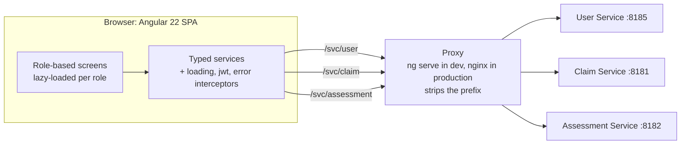
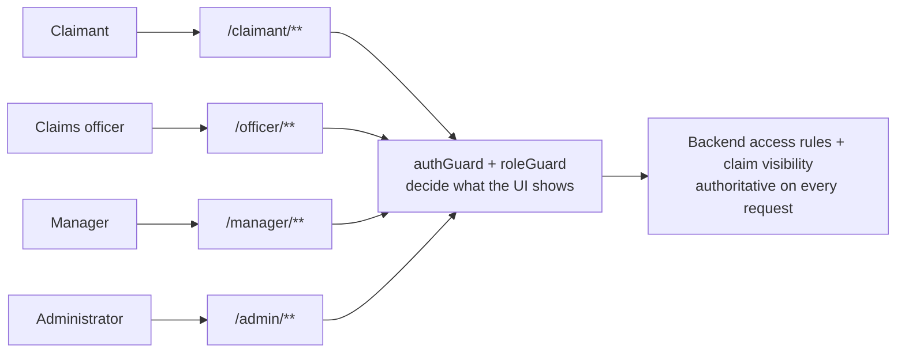
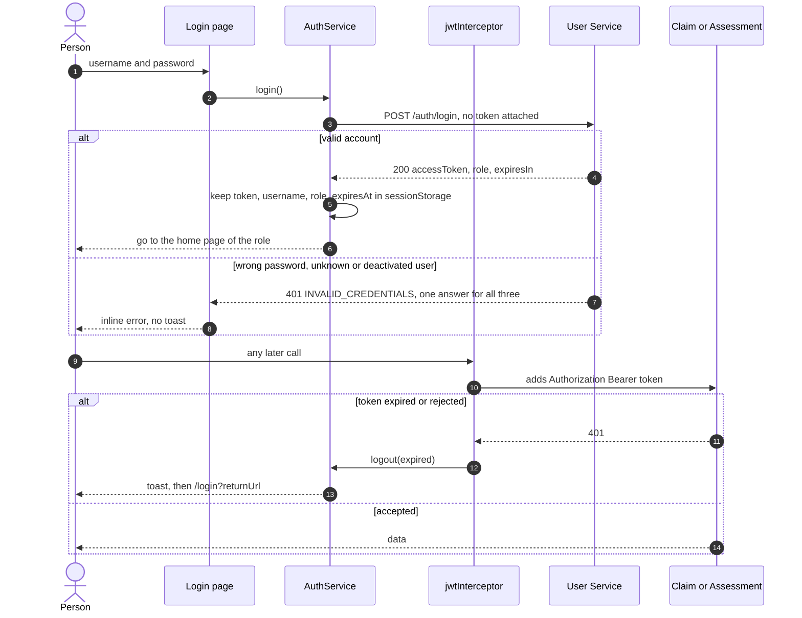
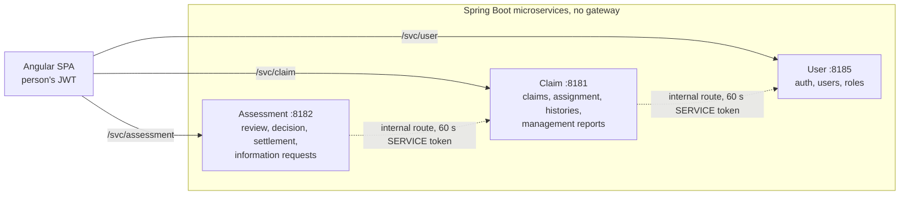
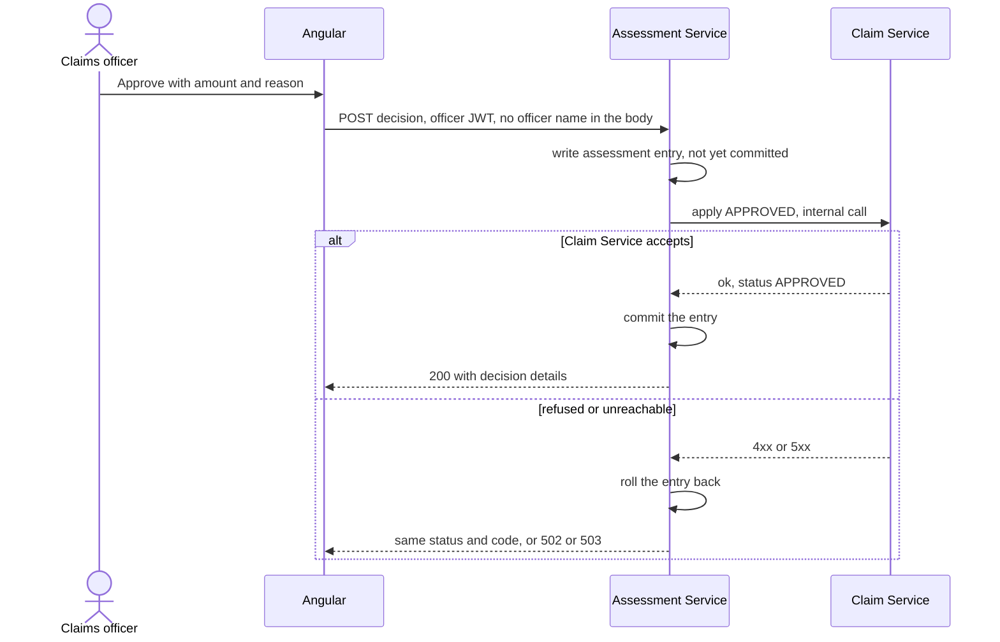
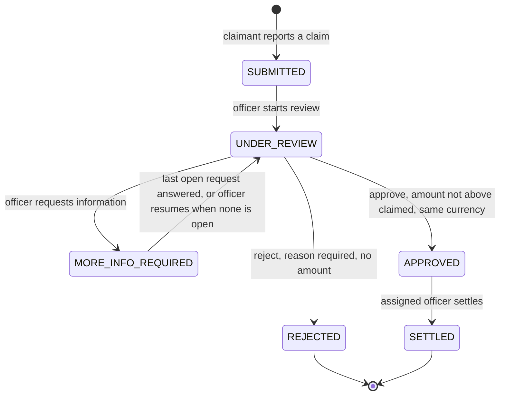
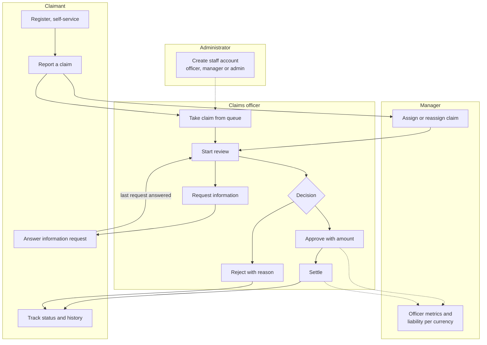
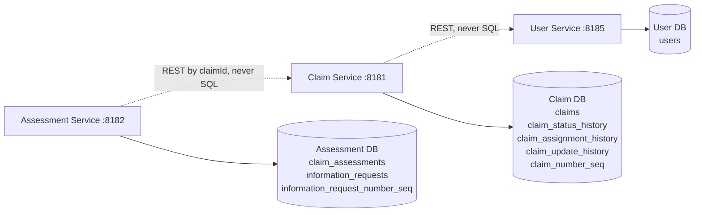
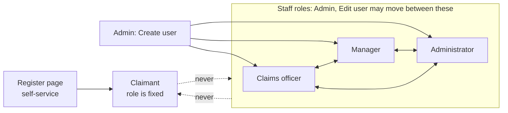
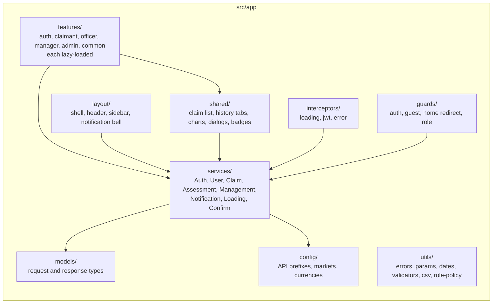

# Chubb APAC Claims Management — Frontend

Angular 22 single-page application for the Chubb APAC claims platform. One codebase serves **claimants, claims officers, managers and administrators**, each with their own menu, guarded routes and screens. It consumes three existing Spring Boot microservices; **the backend is not modified.**

| | |
|---|---|
| **Stack** | Angular 22 (standalone components, signals, zoneless, lazy-loaded role areas) · Angular Material 22 (Material 3) · Chart.js 4 via `ng2-charts` 11 |
| **Auth** | JWT from `POST /api/v1/auth/login`, kept in `sessionStorage` |
| **Backend** | User `:8185` · Claim `:8181` · Assessment `:8182`, reached through a path-prefix proxy (no gateway, no CORS) |
| **Tests** | Vitest: 10 spec files, 143 tests passing. Opt-in end-to-end scripts against a live backend |

**Read next:** [Demo guide](docs/DEMO_GUIDE.md) · [Role policy](docs/ROLE_POLICY.md) · [Project structure](docs/PROJECT_STRUCTURE.md) · [REST contract](endpoints_details.md) · [e2e](e2e/README.md) · [`CLAUDE.md`](CLAUDE.md)

---

## 1. High-level architecture



The backend sends no CORS headers, so the browser only ever talks to its own origin and the proxy forwards each prefix. Change the targets in `proxy.conf.json`; no rebuild is needed per environment.

## 2. Role access model



| Role | Screens | Sees which claims (backend-enforced) |
|---|---|---|
| **Claimant** | Dashboard · Report a claim · My claims · Claim details (tracker, status / assignment / update history) · Edit claim (only while `SUBMITTED`) · Information requests · Profile | Only their own |
| **Claims officer** | Dashboard · Claims queue · Assigned claims · **Review workspace** (Approve, Reject, Request Information side by side; information-requests table; history tabs) · Settlement · Assessment history | Unassigned queue plus their own |
| **Manager** | Overview · Claims · Assignment dashboard · Officer metrics · Liability reports (per currency, CSV) · read-only claim overview | Every claim |
| **Administrator** | Dashboard · User management · Create user · User detail · Edit user (see [section 8](#8-user-management-and-role-policy)) | The backend allows every route; the UI deliberately shows the admin screens only |
| **Everyone** | Sign in · self-registration (always a claimant) · profile · notification bell · toasts · confirmation dialogs | |

A signed-out visit to a protected URL goes to `/login?returnUrl=…`. A signed-in person who opens another role's URL is sent to their own home with a notice. A claim outside the caller's scope answers `404`, exactly like one that does not exist.

## 3. Authentication flow



The token is never put in `localStorage` or a cookie, never logged, and never sent to login or register. A timer signs the person out when the token expires. A role change or deactivation takes effect at the next sign-in, because the backend has no revocation.

## 4. Service communication flow



The dependency graph is fixed and acyclic (Assessment → Claim → User). All three services verify the same JWT with a shared secret. The frontend never calls an `/internal` route.

Approving a claim shows why cross-service work is "best effort" and not transactional:



## 5. Claim lifecycle



Approval and settlement are **two separate steps**; `APPROVED` is not final, and a rejected claim can never be settled. A claimant may edit a claim only while it is `SUBMITTED`. Any other move is `409 INVALID_CLAIM_TRANSITION`. The rules live in the backend; the UI only shows the actions that apply.

## 6. End-to-end business workflow



## 7. Database ownership

The frontend never touches a database. Each service owns its own, and services share data only through REST, referring to a claim by `claimId` (never the internal id, never a foreign key).



In-memory H2 per service by default; PostgreSQL is opt-in per service. Which parts have actually run on PostgreSQL is stated in the backend's own README; this project does not claim more.

## 8. User management and role policy

**Rule:** a self-registered claimant stays a claimant. Claims officer, manager and administrator accounts are provisioned separately by an administrator. Nobody is promoted into a staff role from a claimant account, and a staff account is never turned into a claimant.



| From \ To | Claimant | Claims officer | Manager | Administrator |
|---|---|---|---|---|
| **Claimant** | – | no | no | no |
| **Claims officer** | no | – | yes | yes |
| **Manager** | no | yes | – | yes |
| **Administrator** | no | yes | yes | – |

An administrator can never change their own role (the backend answers `409 CANNOT_CHANGE_OWN_ROLE`, and the UI hides the control).

| Screen | Behaviour |
|---|---|
| Create user | Role list is staff roles only; claimants register themselves |
| Edit user | A claimant sees an explanation and a link to Create user, no picker. A staff member's picker lists staff roles only. The choice is validated, and checked again before anything is sent |
| User detail | "Edit user" is hidden for claimants, with the reason shown |
| User management | Wording says staff accounts and staff roles |

The rule lives in one place, `src/app/utils/role-policy.ts`, and all screens read it.

> **This is a UI rule, not enforcement.** The User Service accepts any role on `PUT /users/{username}/role` and only refuses your own account, so an administrator calling the API directly can still promote a claimant. The service also returns no "self-registered" marker, so the UI cannot tell a self-registered claimant from any other, and **locks every claimant**. Enforcing the rule properly is a backend change; see [docs/ROLE_POLICY.md](docs/ROLE_POLICY.md).

## 9. Project structure



`services/` is the only code that calls `HttpClient`. Components use inline templates, `OnPush` and signals. The largest component is 361 lines. The folder tree, routing table and how to add a page or endpoint are in [`docs/PROJECT_STRUCTURE.md`](docs/PROJECT_STRUCTURE.md).

---

## Quick start

**Prerequisites:** Node.js 22.12+ (developed on 26) and npm 10+ (developed on 11). Java 17 only to run the backend.

```powershell
npm install
# 1. backend, from the backend repository (generates a random shared JWT_SECRET for the run)
.\microservices\scripts\start-all.ps1
# 2. frontend
npm start            # http://localhost:4200, uses proxy.conf.json
```

Health check: `http://localhost:8185/actuator/health` (and 8181, 8182) must answer `{"status":"UP"}`.

In development the login page offers buttons for the backend's seeded demo accounts (hidden in a production build). They exist only while the backend runs with `DEMO_USERS=true` (its default), all with password `password123`; they make this a demo, not a secure deployment.

| Username | Role |
|---|---|
| `claimant1` | Claimant |
| `officer1` | Claims officer |
| `manager1` | Manager |
| `admin1` | Administrator |

| Command | Does |
|---|---|
| `npm run test:ci` | unit tests, single run, no backend needed |
| `npm run build` | production build into `dist/chubb-claims-ui`, applies budgets |
| `npm run e2e:contract` | 80+ checks of every API the app uses, against the live backend (needs backend and `npm start`) |
| `npm run e2e:ui` | 50+ browser steps across all four roles (needs backend, `npm start` and Chrome) |

> This folder is inside OneDrive. `node_modules` is tens of thousands of files; pause sync or move the project if installs feel slow.

### Production hosting

`ng build` produces static files. The server must serve `index.html` for unknown paths and forward the same three prefixes. Use HTTPS: the backend itself speaks plain HTTP.

```nginx
server {
  listen 80;
  root /usr/share/nginx/html;                       # contents of dist/chubb-claims-ui/browser
  location / { try_files $uri $uri/ /index.html; }
  location /svc/user/       { proxy_pass http://user-service:8185/; }        # trailing slash strips the prefix
  location /svc/claim/      { proxy_pass http://claim-service:8181/; }
  location /svc/assessment/ { proxy_pass http://assessment-service:8182/; }
}
```

## Rules the UI relies on (all from the backend)

- **The officer is the token.** The UI never sends an officer name for review, request, decision or settlement.
- **Liability is per currency.** Amounts in different currencies are never added; manager screens show one figure per currency and no cross-currency total.
- **Information requests are text only.** There is no document upload in the backend, so none in the UI.
- **A manager cannot list officers.** `GET /users` is admin-only, so the assign dialog suggests officers from the workload report and accepts a typed login name; the server checks it is an active claims officer.
- **No revocation.** A deactivated or re-roled person's open session works until the token expires (60 minutes by default).

## Known limitations

- **Role policy is UI-only** (section 8). The backend does not enforce it.
- **Notifications are client-side** (toasts and the header bell). Server-pushed notifications are a planned Kafka step; `NotificationService.push()` is the single place to feed them.
- **Light theme only.** No server-side sorting on claim lists (the backend offers none).
- **Admin dashboard counts** read `GET /users` page by page (100 at a time, up to 2,000) because there is no count-by-role.
- **Test coverage is not measured.** There is no coverage tool configured, so the 80% target in `CLAUDE.md` is neither met nor disproved. Only `AuthService` has a service spec. No Lighthouse accessibility audit has been run, so accessibility is built in but not certified.
- **The end-to-end scripts were not updated for the role policy and were not re-run** with it.
- **Not production-ready:** tokens are in `sessionStorage` (readable by script), the backend uses one shared signing secret with no refresh, revocation, lockout or rate limit, and demo accounts are on by default.

## Troubleshooting

| Symptom | Cause / fix |
|---|---|
| "Cannot reach the server" at login | A backend service is down or the proxy port is wrong. Check the three `/actuator/health` URLs |
| Every call is `401` right after login | Services were started with different `JWT_SECRET` values; restart all three with the same one |
| `404` on `/svc/...` | Not running through `npm start` (the proxy exists only in the dev server), or the production server lacks the three `location` blocks |
| Port 8181 in use | The backend's original monolith also defaults to 8181; stop it or move the Claim Service and update `proxy.conf.json` |
| Icons show as words | Run `npm install` so the bundled `material-icons` font is present |
